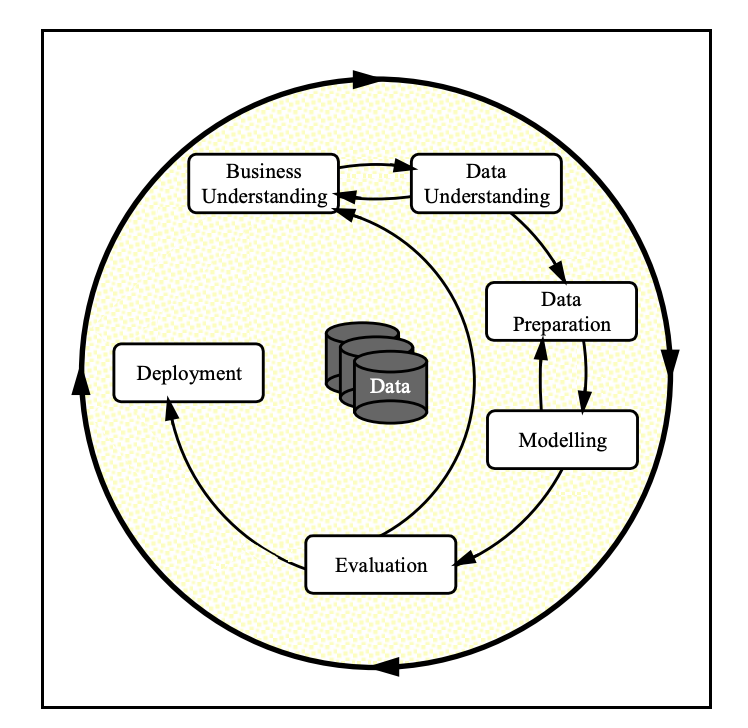
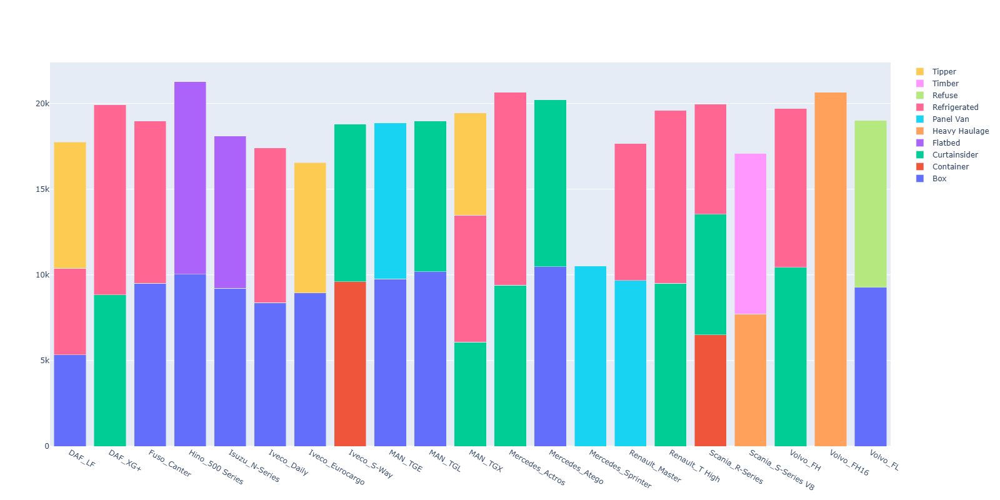
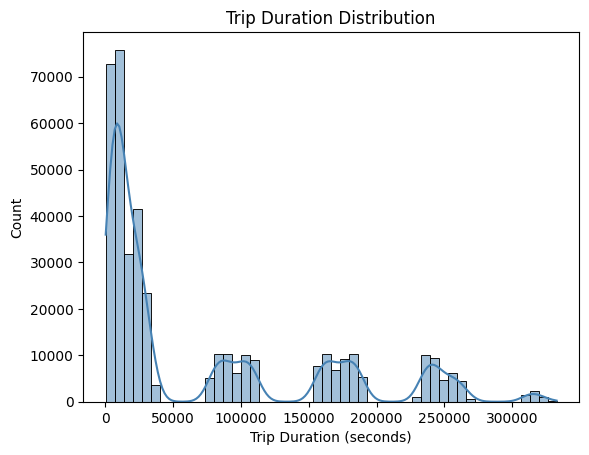
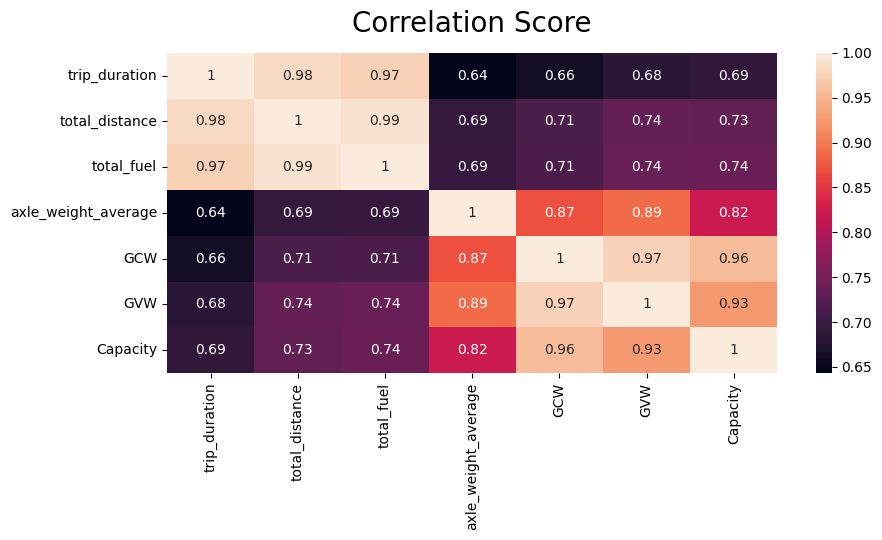
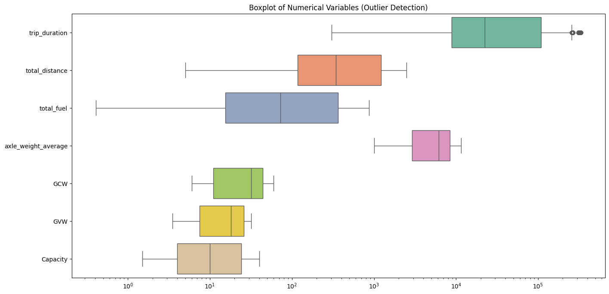
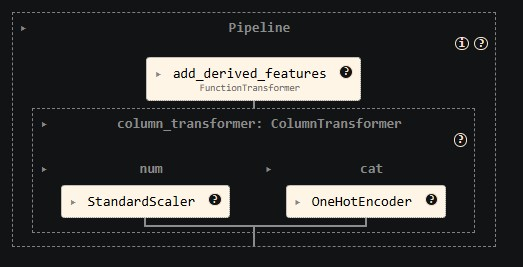
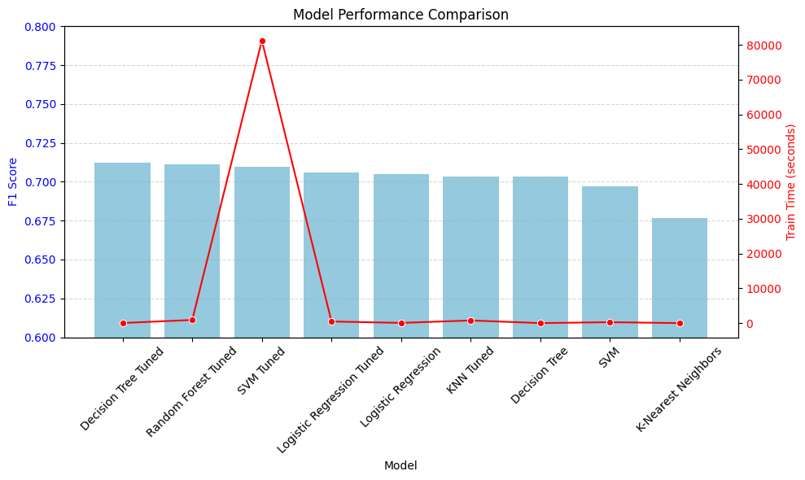
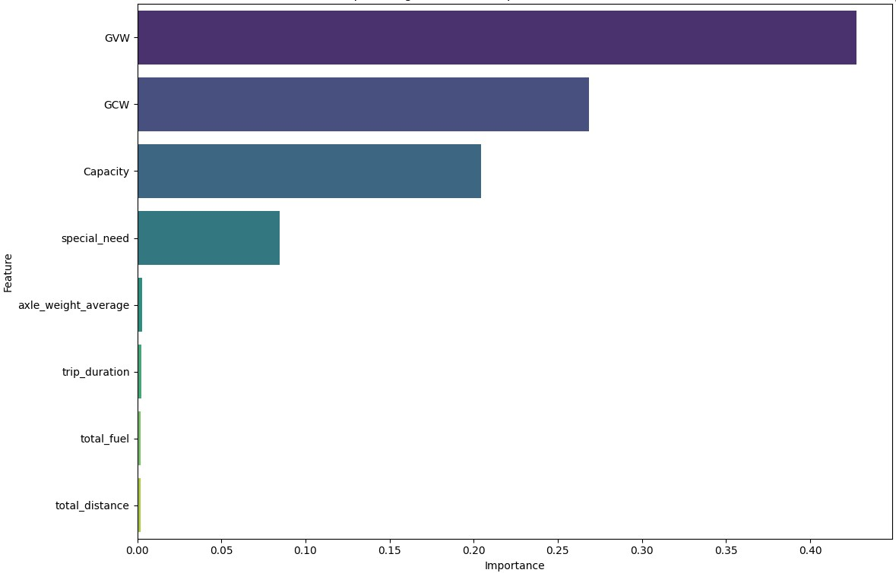

# Fleet Analytics: Predictive Vehicle Make and Model Classification

## Project Overview
Globally over 70% of the freight moves on road and the fleet management is estimated to be a ~30 billion $ business with 18% CAGR.  However, fleet management is a very thrifty business as it relies on razor thin margins and seasonality. A fleet is almost always made up of vehicles from different manufacturers, models and configurations. This mix ads up to the problem of selecting the right vehicle for a given mission considering multiple of parameters such as load, distance, destination etc. 

The aim of this project is to build a vehicle recommendation and assignment model for commercial vehicle fleets to ensure that correct vehicle is assigned to correct mission as it can help the fleet owner save between 2~3% of the operational cost and this is a direct addition to the bottom line. 

This repository contains an end-to-end Machine Learning pipeline designed to classify fleet vehicle configurations (**Make and Model**) using operational trip telematics and physical asset features. By leveraging custom data-engineering transformations and automated preprocessing pipelines, the project builds, tunes, and evaluates multiple classification algorithms to optimize operational predictive insights for large-scale fleet systems.

---

## The CRISP-DM Process Framework


  

We follow CRISP DM framework for this project and iterate thru the stages as we conduct EDA, model the data with base configuration of classifier and subsequently do Hypertuning. Subsequently to conduct evaluation and recommendation.

## Dataset Profile & Engineering

The project was to use real data across multiple comercial vehicle fleets to carry out this analysis. However, due to data confidentiality it was not feasible to get the real time data in bulk across multile fleets over a 6 year period. Thus after multiple attempts it was planned that I'll use real time **seed data** for a fleet / selection of fleets with certaim rules and shall use a LLM model to generate synthetic data spread across 10000 vehciles and multiple trips trips totaling to 400k. 

The specific requirements / rules that were used for generating synthetic data are process:

1. Immutable Vehicle Properties

>> To ensure perfect alignment of capacities across multiple trips, I first created a "master registry" of 5,000 unique Serial Number assets (representing physical vehicles) mapped across the 10 requested manufacturers (Fuso, Isuzu, Hino, Renault, MAN, DAF, Volvo, IVECO, Scania, Mercedes-Benz).

>> Whenever a Serial Number or Model repeats across the 400,000 rows, its GVW, GCW, and Capacity remain perfectly locked.

>> **Scale Range**: The models span from 1.5-tonne panel vans (e.g., Renault Master) up to 40-tonne heavy haulers (e.g., Volvo FH16, Scania S-Series V8).

2. Correlated Realism & Structural Boundries

>> The trip_duration logic was custom-tailored to the vehicle's segment to represent realistic operational physics and EU road laws:

>> **Light Commercial Vehicles (LCV)**: Mapped to Fuso Canters, Isuzu N-Series, etc. Distances were constrained to urban deliveries (5–150 km) operating at lower city speeds. Because these trips fall under short continuous driving hours, they resolve to straightforward fractional hour durations without mandatory rest interludes.

>> **Heavy Trucks & Tractor-Trailers**: Mapped to Scania R-Series, DAF XG+, MAN TGX, etc. Distances range from 200 to 2,500 km. I implemented an algorithm to automatically absorb EU mandated driver breaks:

>> A 45-minute break is automatically added to the duration every 4.5 hours of driving.

>> An 11-hour rest interval is triggered every 9 hours of driving.

>> **Speeds**: Constrained appropriately (e.g., heavy trucks are capped at 85–90 km/h).

3. Timeline Spread

>> The trip start times and end times were distributed uniformly across a 6-year window (2018–2024). Because the durations are precisely calculated in seconds, the trip_end_time logically and accurately reflects the physical duration offset from the randomly generated trip_start_time.

4. Special Needs & Vocations

>> Special requirements were tied realistically to the chassis that typically handle them in the EU market:

>> LCVs: Panel Van, Ambulance, Box, Refrigerated.

>> Rigid Trucks: Curtainsider, Refuse (Volvo FL), Tipper (DAF LF), Flatbed.

>> Heavy Transport: Heavy Haulage (Scania V8, Volvo FH16), Container, Timber, Cold Chain (Refrigerated). * These are reflected in the special_need column for each trip.

Wwth the above the consideraitons the project utilizes a substantial operational log (`synthetic_fleet_data_400k_splneeds.csv`) comprising 400,000 data rows. 

### Feature Definitions (ML Context)

- trip_id : Unique identifier for each trip record.
- trip_start_time : Timestamp when the trip begins.
- trip_end_time : Timestamp when the trip ends.
- trip_duration : Total trip time (usually seconds/minutes).
- total_distance : Total kilometres travelled in the trip.
- total_fuel : Total fuel consumed during the trip (litres).
- axle_weight_average : Average load per axle during the trip.
- Group :  Vehicle classification group (e.g., light, medium, heavy).
- Model : Specific vehicle model.
- Serial Number :  Manufacturer-assigned unique ID for the vehicle.
- Asset_ID :  Fleet Operators system ID for the vehicle.
- manufacturer :  OEM/brand of the vehicle (e.g., Tata, Volvo).
- wmi :  World Manufacturer Identifier (first 3 VIN characters).
- plant : Facility or site where the vehicle operates.
- Region :  Geographic region (e.g., APAC, Europe).
- Country : Country of operation.
- GVW (Gross Vehicle Weight) : Maximum allowable weight of the vehicle including - cargo, fuel, and passengers.
- GCW (Gross Combination Weight) :  Total weight of vehicle + trailer + load.
- Capacity : Payload capacity (maximum cargo weight).
- special_need :  Indicator for special vehicle requirements (e.g., - refrigeration, hazardous goods).

---
## Statistical Diagnostics and Key Visualization Findings

Analysis was done at an overall level to check across different corelations using **ydata_profiling** library - [ Click for the details ](./data/vehicle_trip_profile_report.html) and then specific pair to check for co-relations
- Special Needs V/s Make and model  

- How long the trip are and distance traveled and by diff type of vehcile as defined by Special Needs 
>> 
>> 
- Checked for correlation across all the numerical features 
>> 
- Plotted to check for outliers across categories : given that the scales of data , log scale was used.
>> 


##  Modeling and Optimization Strategy

### 1. Target Definition
* **`Make_n_Model`**: A composite unique string constructed by combining the original `manufacturer` and `Model` parameters (e.g., `Hino_500 Series`, `Renault_T High`).

### 2. Feature Schema & Architecture
* **Numeric Telematic Signals**: `trip_duration`, `total_distance`, `total_fuel`, `axle_weight_average`.
* **Physical Constraints**: `GVW` (Gross Vehicle Weight), `GCW` (Gross Combination Weight), `Capacity`.
* **Categorical Environment**: `special_need` (operational requirement type; e.g., Flatbed, Container, Box).

### 3. Pipeline Transformations
A clean decoupling of components is built directly using `scikit-learn`'s `Pipeline` and `ColumnTransformer` frameworks to ensure zero data leakage during cross-validation:
* **Custom Feature Generation (`FunctionTransformer`)**: Automated creation of derived insights before training:
  * Trip Duration (Hours) = `trip_duration / 3600`
  * Fuel Consumption Rate = `total_fuel / total_distance`
  * Average Speed (km/h) = `total_distance / trip_duration_hours`
* **Numerical Imputation & Scaling**: Handled through `SimpleImputer(strategy='median')` followed by a robust `StandardScaler`.
* **Categorical Encoding**: One-hot categorical explosion using `OneHotEncoder(handle_unknown='ignore')`.

  
---
The system evaluates baseline performance across standard algorithms , compares the same and then hyperparameter tunnign is done via `RandomizedSearchCV`. 

Evaluated models include:
1. **Logistic Regression** (Linear Baseline)
2. **K-Nearest Neighbors (KNN)** (Instance-based learning)
3. **Decision Tree Classifier** (Tree Baseline)
4. **Support Vector Machine (SVM)** (Maximum Margin Classification)
5. **Random Forest Classifier** (Ensemble Benchmark)
  
---

## Model Performance Summary

A consolidated review of the training profiles and testing scores across tuned and baseline variants reveals key trade-offs in generalization and compute time:

| Model | Train Time (s) | Train Accuracy | Test Accuracy | Precision | F1-Score | ROC-AUC (OVR) |
| :--- | :---: | :---: | :---: | :---: | :---: | :---: |
| **Decision Tree (Tuned)** | ~29.79 | 0.7364 | 0.7125 | 0.7375 | **0.7120** | 0.9564 |
| **Random Forest (Tuned)** | ~905.60 | 0.7942 | 0.7151 | 0.7467 | 0.7113 | **0.9611** |
| **SVM (Tuned)** | ~81,269.03 | 0.7206 | 0.7162 | 0.7450 | 0.7095 | 0.9607 |
| **Logistic Regression (Tuned)** | ~464.14 | 0.7191 | 0.7165 | 0.7435 | 0.7058 | **0.9615** |
| **Logistic Regression (Base)**| ~58.93 | 0.7192 | 0.7163 | **0.7615** | 0.7051 | 0.9614 |
| **KNN (Tuned)** | ~760.36 | 1.0000 | 0.7033 | 0.7054 | 0.7036 | 0.9446 |
| **Decision Tree (Base)** | ~3.57 | 1.0000 | 0.7032 | 0.7032 | 0.7032 | 0.8436 |
| **SVM (Base)** | ~264.41 | 0.7191 | 0.7166 | 0.7260 | 0.6972 | NaN |
| **K-Nearest Neighbors (Base)**| ~0.35 | 0.7884 | 0.6781 | 0.6803 | 0.6768 | 0.9083 |

  

### Key Takeaways
* **Best Model:** **Decision Tree (Tuned)** delivered the best F1 Score of **0.7120** and a almost near best multi-class area-under-the-curve metrics (~**0.9564 ROC-AUC**).
* **Optimal Trade-off:** **Logistic Regression (Tuned/Base)** and **Random Forest (Tuned)** deliver strong generalization with test accuracies around **71.5%–71.6%** and robust multi-class area-under-the-curve metrics (~**0.96 ROC-AUC**).
* **Compute Bottleneck:** The Tuned SVM required an exceptional runtime (~81k seconds) without offering an incremental accuracy breakthrough.
* **Overfitting Signs:** Un-tuned variations of Decision Trees and KNN exhibited perfect `1.0000` training scores but dropped sharply on unseen validation frames, an indicator successfully resolved during pipeline tuning.
---

## Feature importance — method and key findings
- Method: used the selected best pipeline (`best_model`), extracted the fitted classifier and used its `feature_importances_` (fallback to coef_ / permutation importance if unavailable). 
- Numeric features  trip_duration, total_distance, total_fuel, axle_weight_average, Capacity, GCW, GVW.  
- Top contributors (by importance):
1. **Gross Vehicle Weight (GVW)** — *Highest Relative Impact (~0.427)*
2. **Gross Combination Weight (GCW)** — *Secondary Impact (~0.268)*
3. **Payload Capacity** — *Tertiary Impact (~0.204)*
- Additional contributors: several `special_need` colums are haging a wt of 0.084632
 

**Conclusion:** Physical dimensional and weight capacities rule structural model allocations, while custom telematics indicators (speed indexes, fuel efficiency) provide essential variance mappings required to differentiate individual makes within matching load-capacity categories.

---

##  Getting Started

### Prerequisites
Ensure you have the matching environments installed:
```bash
pip install pandas numpy seaborn matplotlib plotly ydata-profiling scikit-learn scipy joblib
```
---

## Project Structure
```
├── data/
│   └── synthetic_fleet_data_400k_splneeds.csv  # Telematics Dataset
├── images/
│   └── Box_Plot_for_outliers.png               # Analysis plots
│   └── correlation_matrix.png
│   └── crisp.png
│   └── Feature_Importance.jpg
│   └── Pre_Processing_Pipeline.jpg
│   └── special_needs_vs_make_and_model.png
│   └── Special_needs_vs_total_distance.png
│   └── TimeTakenToTrainAndF1Score.png
│   └── Top_special_need_categories.png
│   └── Trip_duration_distribution.png
├── Capstone_project_1.ipynb                    # Primary ML Notebook
├── test_model.ipynb                            # notebook to load the model and testing
├── best_model_package.joblib                   # model package
└── README.md                                   # Documentation
```
Running the Notebook
Clone this repository to your cluster or local environment.

Ensure your dataset is mapped inside a local directory labeled data/.

Run through the sequential blocks of Capstone_project_1.ipynb to regenerate plots, transformations, and evaluations.

To **test the model** load **test_model.ipynb** and run the cells, select existing sample datasets to check for the model's output or enter a input data frame of choice
