### Project Title
# Intelligent Fleet Recommendation and Optimization System
(for European Commercial Fleet Telemetry Analysis and Vehicle Classification)

**Author**
Rajeev Batra

#### Executive summary

Globally over 70% of the freight moves on road and the fleet management is estimated to be a 30 billion $ business with 18% CAGR.  However, fleet management is a very thrifty business as it relies on razor thin margins and seasonality. A fleet is almost always made up of vehicles from different manufacturers, models and configurations. This ads up to the problem of selecting the right vehicle for a given mission considering multiple of parameters such as load, distance, destination etc. 
The aim of this project is to build a vehicle recommendation and assignment model for commercial vehicle fleets to ensure that correct vehicle is assigned to correct mission as it can help the fleet owner save between 2~3% of the operational cost and this is a direct addition to the bottom line. 

#### Rationale
**Why should anyone care about this question?**

 Over 70% of global freight moves by road, yet trucking and fleet operators work on razor-thin profit margins where a few cents per mile determine whether a trip makes or loses money. Most commercial fleets own a mixed fleet of trucks from different manufacturers and sizes, and dispatchers often assign whichever truck is simply available first rather than the one best suited for that specific load and route. When this problem goes unanswered, fleets routinely send oversized trucks on light runs or fuel-heavy models onto long hauls—wasting thousands of gallons of fuel, accelerating wear and tear, and eating directly into company survival during slow seasons. By translating complex vehicle and route trade-offs into a simple "best truck for this trip" recommendation that any dispatcher can use without a data science background, this analysis helps fleet owners cut 2–3% off their daily operating costs—savings that flow straight to their bottom line while reducing unnecessary fuel emissions.
 
#### Research Question
**What are you trying to answer?**

How can we match commercial fleet vehicles to freight missions based on load, route, and special handling needs to minimize under-utilization and reduce trip operating costs by 2–3% and this is big savings given the razor thin  margins in fleet management.

#### Data Sources
**What data will you use to answer you question?**

Because commercial carriers treat multi-year fleet telematics as proprietary, gathering bulk historical records across multiple fleets over a six-year window was not feasible due to data confidentiality. Instead,  based on the discussion with the learning facilitator I combined real-world fleet seed data with a rule-constrained LLM generation pipeline to build a realistic dataset of 400,000 trips across 10,000 unique vehicles spanning 2018–2024. To ensure the synthetic data reflects actual commercial operations, the generation process enforces four domain rules:

Immutable Vehicle Registry: A master registry locks physical specifications—Gross Vehicle Weight (GVW), Gross Combination Weight (GCW), and payload capacity—to unique serial numbers across 10 manufacturers (Fuso, Isuzu, Hino, Renault, MAN, DAF, Volvo, IVECO, Scania, and Mercedes-Benz), ranging from 1.5-tonne panel vans (Renault Master) to 40-tonne heavy haulers (Volvo FH16, Scania S-Series V8).

Physics and Regulatory Constraints: Trip distances, speeds, and durations follow vehicle segment physics and EU road laws—limiting Light Commercial Vehicles (LCVs) to short urban deliveries (5–150 km) while capping heavy trucks (200–2,500 km) at 85–90 km/h and automatically inserting EU-mandated 45-minute breaks every 4.5 driving hours and 11-hour rest intervals every 9 driving hours.

Six-Year Timeline Alignment: Trip start times are distributed across a 2018–2024 window, with end timestamps calculated to the exact second from driving time plus mandatory rest offsets.

Chassis-Matched Vocations: Special mission needs are paired with appropriate chassis configurations, mapping urban box and refrigerated units to LCVs, tippers and refuse bodies to medium rigid trucks (such as DAF LF and Volvo FL), and cold-chain, container, timber, and heavy haulage to high-tonnage tractors.

#### Methodology
**What methods are you using to answer the question?**

Following the CRISP-DM framework, I will begin with Exploratory Data Analysis (EDA), feature encoding, and L1/L2 regularization to handle mixed vehicle and route attributes. I will then train and compare classification and recommendation algorithms—including K-Nearest Neighbors (KNN), tree-based ensembles, SVM and regularized linear models—evaluated on Accuracy, Precision, Recall, and F1-Score, paired with a custom cost-benefit loss function that explicitly penalizes payload under-utilization and excess fuel burn.

#### Results
**What did your research find?**

The project will produce a decision-support recommendation tool that ranks and assigns the most cost-effective available vehicle for any incoming freight order, accompanied by a business dashboard comparing projected fuel and operating expenses against baseline manual dispatch decisions.

#### Next steps
**What suggestions do you have for next steps?**

## 1. Dataset Overview, Schema Dictionary and Data Cleaning

### 1.1 High-Level Dataset Summary (`ydata-profiling` Audit)

| Metric | Raw Dataset | Cleaned EDA Dataset | Analytical and Modeling Impact |
| :--- | ---: | ---: | :--- |
| **Total Observations (Rows)** | 400,000 | 391,204 | **8,796 rows (`2.20%`)** removed where `special_need == 'Ambulance'` |
| **Total Columns** | 19 | 19 | `trip_id` dropped (`-1`); `Make_n_Model` target engineered (`+1`) |
| **Missing Cells** | 0 (`0.0%`) | 0 (`0.0%`) | Confirmed via `vtd_df.isnull().sum()` and Cell 17 heatmap |
| **Duplicate Rows** | 0 (`0.0%`) | 0 (`0.0%`) | Zero duplicate trip records |
| **Memory Footprint** | 58.0+ MB | 263.2 MiB (profiled) | 7 numerical, 9 categorical, 2 date, and 1 text (`Serial Number`) variables |
| **Date Coverage** | 2018-01-01 to 2023-12-31 | 2018-01-01 to 2023-12-31 | 2,191 distinct start dates; `trip_end_time` extends to 2024-01-03 (2,194 dates) |

### 1.2 Complete Feature Dictionary and Leakage Audit  < need to clean the ML Pipeline Role column >

| # | Column Name | Dtype | Distinct | Example Values | Description | ML Pipeline Role |
| :-: | :--- | :--- | ---: | :--- | :--- | :--- |
| 1 | `trip_id` | `int64` | 400,000 | `158815423` | Unique trip record key | **Dropped in Cell 8** (Zero predictive power) |
| 2 | `trip_start_time` | `date` | 2,191 | `2022-11-07` | Trip start date | **Engineer and Drop Raw** (Extract `trip_month`, `trip_dayofweek`) |
| 3 | `trip_end_time` | `date` | 2,194 | `2022-11-07` | Trip completion date | **Engineer and Drop Raw** (Extract `trip_span_days`) |
| 4 | `trip_duration` | `int64` | 108,270 | `18985`, `241463` | Total trip duration in seconds (`305` to `332,649 s`) | **Core Numerical Feature** (Telemetry) |
| 5 | `total_distance` | `float64` | 153,172 | `337.59`, `2246.18` | Total trip distance in km (`5.00` to `2,499.99 km`) | **Core Numerical Feature** (Telemetry) |
| 6 | `total_fuel` | `float64` | 74,026 | `64.02`, `671.50` | Total fuel consumed in litres (`0.41` to `874.01 L`) | **Core Numerical Feature** (Telemetry) |
| 7 | `axle_weight_average` | `int64` | 10,501 | `3338`, `11019` | Average axle load in kg (`1,000` to `11,500 kg`) | **Core Numerical Feature** (Payload Telemetry) |
| 8 | `special_need` | `object` | 10 | `Box`, `Refrigerated` | Cargo body / special operational requirement | **Core Categorical Feature** (`OneHotEncoder`) |
| 9 | `Country` | `object` | 8 | `France`, `Italy` | Country of operation (8 European markets) | **Categorical Feature** (`OneHotEncoder`) |
| 10 | `GCW` | `float64` | 11 | `32.0`, `44.0`, `60.0` | Gross Combination Weight (`6.0` to `60.0 t`) | **Static Vehicle Spec** (Used in Track B; omitted in Track A) |
| 11 | `GVW` | `float64` | 10 | `16.0`, `26.0`, `32.0` | Gross Vehicle Weight (`3.5` to `32.0 t`) | **Static Vehicle Spec** (Used in Track B; omitted in Track A) |
| 12 | `Capacity` | `float64` | 9 | `9.0`, `24.0`, `40.0` | Maximum payload capacity (`1.5` to `40.0 t`) | **Static Vehicle Spec** (Used in Track B; omitted in Track A) |
| 13 | `Region` | `object` | 1 | `Europe` | Geographic region (`100%` `"Europe"`) | **Drop — Constant Feature** (Zero variance across all rows) |
| 14 | `Serial Number` | `object` | 4,879 | `EU107265` | Unique physical vehicle ID (`EU` + 6 digits) | **Drop — Target Leakage** (Maps 1:1 to a single `Make_n_Model`) |
| 15 | `Group` | `object` | 21 | `JHD500SERIES` | Internal fleet group code (`wmi + Model`) | **Drop — Target Leakage** (1:1 deterministic alias of `Make_n_Model`) |
| 16 | `manufacturer` | `object` | 10 | `Volvo`, `MAN` | Vehicle OEM brand | **Drop — Direct Target Leakage** (First half of target string) |
| 17 | `Model` | `object` | 21 | `500 Series`, `FH16` | Vehicle model name | **Drop — Direct Target Leakage** (Second half of target string) |
| 18 | `wmi` | `object` | 11 | `YV2`, `WMA`, `ZCF` | World Manufacturer Identifier | **Drop — Target Leakage** (Maps deterministically to `manufacturer`) |
| 19 | `plant` | `object` | 44 | `YV2PLANT1` | Operating plant code (`wmi + PLANT1..4`) | **Drop — Target Leakage** (Prefix leaks `wmi` and `manufacturer`) |
| 20 | **`Make_n_Model`** | `object` | **21** | `Hino_500 Series` | **Target Variable (`y`)**: `manufacturer + '_' + Model` | **Target Label (`y`)** |

### 1.3 Missing Data Evaluation 

The , `sns.heatmap(vtd_df.isna())` evaluates missingness across all `391,204` rows and `19` columns, confirming **0.0% missing values**:

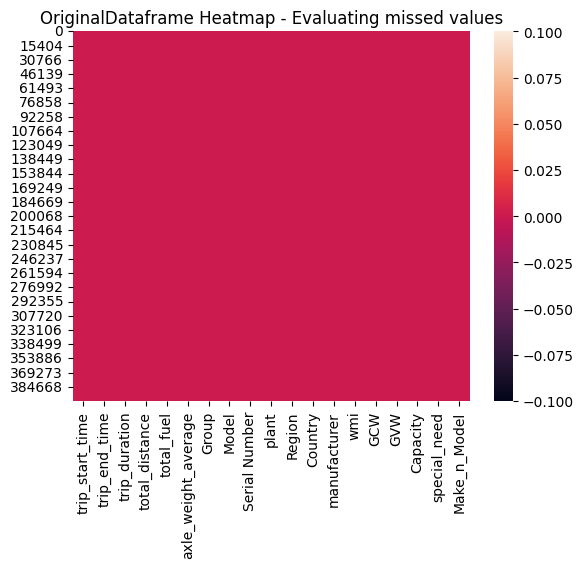

## 2. Exploratory Data Analysis (EDA) and Visual Findings

### 2.1 Numerical Feature Distributions and Log-Scale Outlier Detection 

Because the 7 numerical variables span five orders of magnitude (`Capacity` starting at `1.5 tonnes` vs. `trip_duration` reaching `332,649 seconds`), below horizontal boxplots on a logarithmic scale (`plt.xscale('log')`):

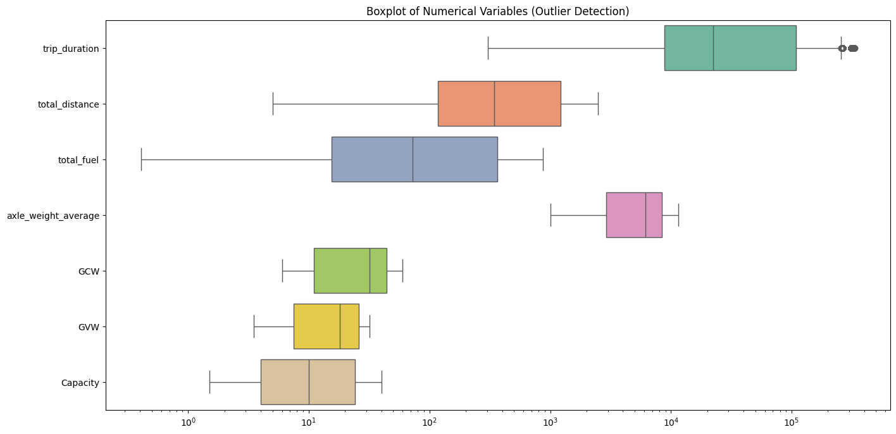

| Numerical Feature | Mean | Std Dev | Min | 5th % | Q1 (25%) | Median (50%) | Q3 (75%) | 95th % | Max | IQR | Skewness | CV |
| :--- | ---: | ---: | ---: | ---: | ---: | ---: | ---: | ---: | ---: | ---: | ---: | ---: |
| **`trip_duration` (s)** | 70,067.53 | 85,129.21 | 305.00 | 2,742.00 | 8,879.00 | 22,472.00 | 108,458.50 | 247,451.00 | 332,649.00 | 99,579.50 | +1.192 | 1.215 |
| **`total_distance` (km)** | 700.94 | 744.27 | 5.00 | 32.87 | 117.17 | 343.18 | 1,222.42 | 2,247.56 | 2,499.99 | 1,105.25 | +1.012 | 1.062 |
| **`total_fuel` (L)** | 199.30 | 232.36 | 0.41 | 3.66 | 15.54 | 72.69 | 363.12 | 674.06 | 874.01 | 347.58 | +1.048 | 1.166 |
| **`axle_weight_average` (kg)** | 5,907.91 | 3,073.89 | 1,000.00 | 1,387.00 | 2,925.00 | 6,145.00 | 8,439.00 | 10,888.00 | 11,500.00 | 5,514.00 | +0.076 | 0.520 |
| **`GCW` (tonnes)** | 31.87 | 16.46 | 6.00 | 7.00 | 11.00 | 32.00 | 44.00 | 60.00 | 60.00 | 33.00 | -0.115 | 0.516 |
| **`GVW` (tonnes)** | 18.15 | 8.73 | 3.50 | 5.00 | 7.50 | 18.00 | 26.00 | 32.00 | 32.00 | 18.50 | -0.252 | 0.481 |
| **`Capacity` (tonnes)** | 15.66 | 11.73 | 1.50 | 2.50 | 4.00 | 10.00 | 24.00 | 40.00 | 40.00 | 20.00 | +0.584 | 0.749 |

### 2.2 Correlation Analysis and Multicollinearity Structure 

We compute `vtd_df.corr(numeric_only=True)` and renders an annotated heatmap revealing **two tightly coupled collinear clusters**:

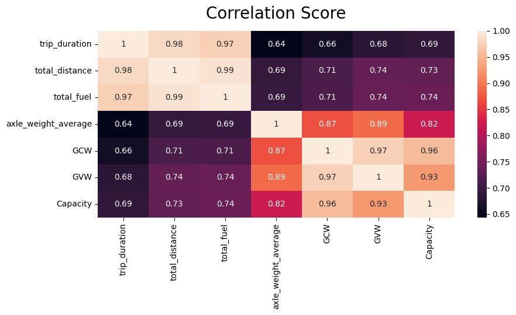

| Feature | `trip_duration` | `total_distance` | `total_fuel` | `axle_weight_average` | `GCW` | `GVW` | `Capacity` |
| :--- | ---: | ---: | ---: | ---: | ---: | ---: | ---: |
| **`trip_duration`** | **1.0000** | **0.9824** | **0.9736** | 0.6432 | 0.6604 | 0.6825 | 0.6892 |
| **`total_distance`** | **0.9824** | **1.0000** | **0.9908** | 0.6921 | 0.7132 | 0.7359 | 0.7331 |
| **`total_fuel`** | **0.9736** | **0.9908** | **1.0000** | 0.6948 | 0.7146 | 0.7380 | 0.7405 |
| **`axle_weight_average`** | 0.6432 | 0.6921 | 0.6948 | **1.0000** | **0.8695** | **0.8896** | **0.8210** |
| **`GCW`** | 0.6604 | 0.7132 | 0.7146 | **0.8695** | **1.0000** | **0.9749** | **0.9567** |
| **`GVW`** | 0.6825 | 0.7359 | 0.7380 | **0.8896** | **0.9749** | **1.0000** | **0.9254** |
| **`Capacity`** | 0.6892 | 0.7331 | 0.7405 | **0.8210** | **0.9567** | **0.9254** | **1.0000** |

### 2.3 Multi-Modal Trip Duration and 3-Tier Staircase Pairplot 

The data reveals two structural signatures of commercial European fleet operations:

1. **Five Multi-Modal Trip Duration Peaks**:
   - `trip_duration` separates into **5 discrete operational regimes** separated by mandatory EU tachograph daily rest periods (`11 hours = 39,600 seconds`) between driving shifts on multi-day trips:

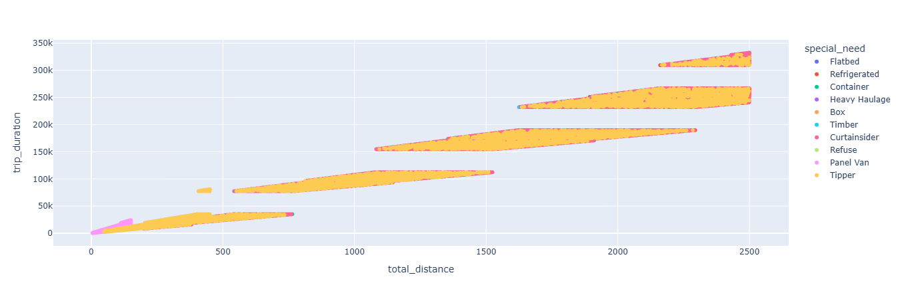

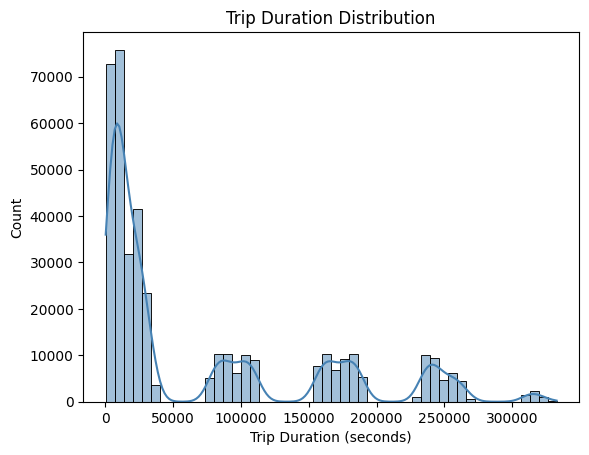

2. **Three-Tier Vehicle Staircase in the Corner Pairplot**:
   - Inspecting the pairplot scatter subplots of `axle_weight_average`, `total_distance`, and `total_fuel` uncovers **3 exact operational vehicle tiers** built into the dataset:
     - **Tier 1 — Light Commercial Vans (`GCW 6–11t, Cap 1.5–4t`)**: Distance `5–150 km`, Fuel Rate `8–15 L/100km`, Axle Weight `1,000–3,000 kg`.
     - **Tier 2 — Medium-Duty Rigid Trucks (`GCW 24–32t, Cap 6–10t`)**: Distance `50–450 km`, Fuel Rate `15–25 L/100km`, Axle Weight `3,000–7,000 kg`.
     - **Tier 3 — Heavy-Duty Articulated Trucks (`GCW 44–60t, Cap 24–40t`)**: Distance `200–2,500 km`, Fuel Rate `25–35 L/100km`, Axle Weight `6,000–11,500 kg`.

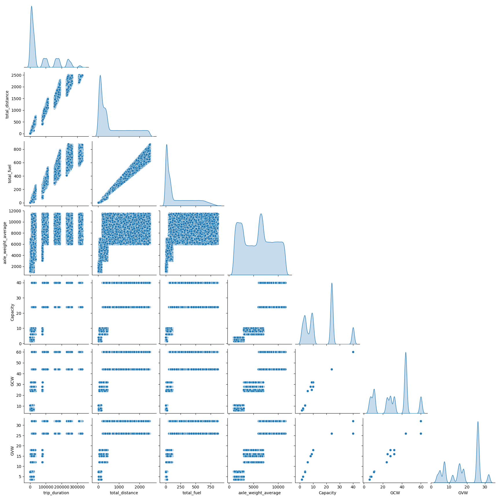

### 2.4 Special Need Category Distribution and Boxplots

Next we compare `trip_duration`, `total_fuel`, and `total_distance` across all 10 `special_need` cargo categories, while **Cells 24 and 27** rank the category trip counts:

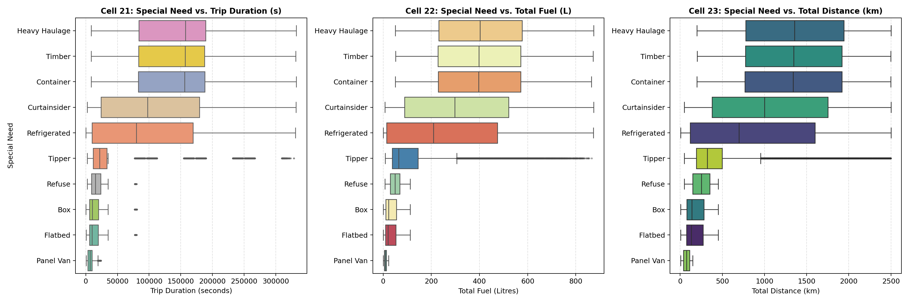

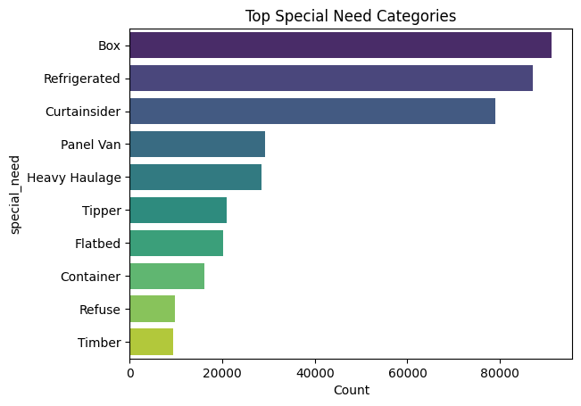

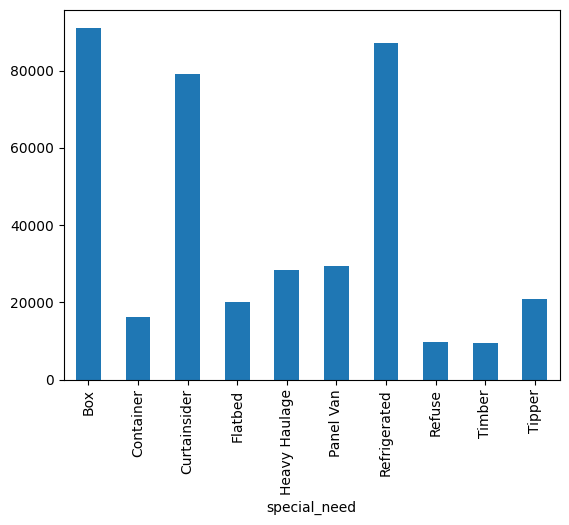

| Special Need | Trip Count | Share (%) | Unique Models | Mode (`top`) Vehicle | Mode `freq` (Share of Category) | Median Duration (s / hrs) | Distance Q1 – Median – Q3 (km) | Fuel Q1 – Median – Q3 (L) | Active Weight Tiers |
| :--- | ---: | ---: | ---: | :--- | ---: | ---: | ---: | ---: | :--- |
| **Box** | 91,111 | 23.29% | 10 | `Mercedes_Atego` | 10,482 (`11.5%`) | 10,321 s (2.87 h) | 79.2 – **137.8** – 281.9 | 10.3 – **22.6** – 55.3 | Light (4), Medium (6) |
| **Refrigerated** | 87,065 | 22.26% | 10 | `Mercedes_Actros` | 11,260 (`12.9%`) | 79,774 s (22.16 h) | 119.0 – **698.6** – 1,600.8 | 13.9 – **208.4** – 474.6 | Light (3), Med (1), Heavy (6) |
| **Curtainsider** | 79,073 | 20.21% | 9 | `Volvo_FH` | 10,447 (`13.2%`) | 97,499 s (27.08 h) | 377.5 – **1,001.9** – 1,753.2 | 88.2 – **297.5** – 520.7 | Medium (2), Heavy (7) |
| **Panel Van** | 29,305 | 7.49% | 3 | `Mercedes_Sprinter` | 10,526 (`35.9%`) | 6,519 s (1.81 h) | 40.5 – **77.0** – 113.6 | 4.5 – **8.6** – 12.7 | Light (3) |
| **Heavy Haulage** | 28,387 | 7.26% | 2 | `Volvo_FH16` | 20,667 (`72.8%`) | 157,339 s (43.71 h) | 779.3 – **1,358.4** – 1,941.0 | 231.5 – **402.7** – 576.7 | Heavy (2) |
| **Tipper** | 20,947 | 5.35% | 3 | `Iveco_Eurocargo` | 7,612 (`36.3%`) | 21,725 s (6.03 h) | 192.4 – **321.7** – 497.0 | 37.3 – **64.4** – 144.6 | Medium (2), Heavy (1) |
| **Flatbed** | 20,121 | 5.14% | 2 | `Hino_500 Series` | 11,238 (`55.9%`) | 10,018 s (2.78 h) | 75.6 – **131.7** – 270.6 | 9.5 – **19.5** – 53.0 | Light (1), Medium (1) |
| **Container** | 16,091 | 4.11% | 2 | `Iveco_S-Way` | 9,592 (`59.6%`) | 156,209 s (43.39 h) | 766.2 – **1,339.1** – 1,918.0 | 229.0 – **396.9** – 570.7 | Heavy (2) |
| **Refuse** | 9,738 | 2.49% | 1 | `Volvo_FL` | 9,738 (**`100.0%`**) | 15,138 s (4.21 h) | 149.3 – **252.2** – 352.7 | 29.1 – **49.2** – 69.0 | Medium (1) |
| **Timber** | 9,366 | 2.39% | 1 | `Scania_S-Series V8` | 9,366 (**`100.0%`**) | 156,900 s (43.58 h) | 772.9 – **1,345.7** – 1,917.7 | 228.0 – **397.9** – 570.8 | Heavy (1) |

### 2.5 Target (`Make_n_Model`) vs. `special_need` Stacked Distribution

The stacked bar chart of `pd.crosstab(vtd_df['Make_n_Model'], vtd_df['special_need'])` reveals that every vehicle model operates in only **1, 2, or at most 3 `special_need` categories**:

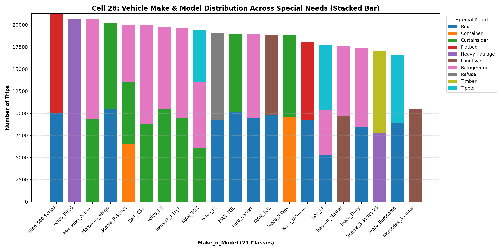

| Rank | `Make_n_Model` (Target `y`) | Total Trips | Share (%) | Weight Tier | `GCW` (t) | `GVW` (t) | `Capacity` (t) | Exact `special_need` Breakdown |
| :-: | :--- | ---: | ---: | :---: | ---: | ---: | ---: | :--- |
| 1 | **`Hino_500 Series`** | 21,272 | 5.44% | Medium | 32.0 | 16.0 | 9.0 | `Flatbed` (11,238), `Box` (10,034) |
| 2 | **`Volvo_FH16`** | 20,667 | 5.28% | Heavy | 60.0 | 32.0 | 40.0 | `Heavy Haulage` (20,667) |
| 3 | **`Mercedes_Actros`** | 20,652 | 5.28% | Heavy | 44.0 | 26.0 | 24.0 | `Refrigerated` (11,260), `Curtainsider` (9,392) |
| 4 | **`Mercedes_Atego`** | 20,217 | 5.17% | Medium | 28.0 | 15.0 | 8.0 | `Box` (10,482), `Curtainsider` (9,735) |
| 5 | **`Scania_R-Series`** | 19,972 | 5.11% | Heavy | 44.0 | 26.0 | 24.0 | `Curtainsider` (7,038), `Container` (6,499), `Refrigerated` (6,435) |
| 6 | **`DAF_XG+`** | 19,935 | 5.10% | Heavy | 44.0 | 26.0 | 24.0 | `Refrigerated` (11,092), `Curtainsider` (8,843) |
| 7 | **`Volvo_FH`** | 19,726 | 5.04% | Heavy | 44.0 | 26.0 | 24.0 | `Curtainsider` (10,447), `Refrigerated` (9,279) |
| 8 | **`Renault_T High`** | 19,593 | 5.01% | Heavy | 44.0 | 26.0 | 24.0 | `Refrigerated` (10,082), `Curtainsider` (9,511) |
| 9 | **`MAN_TGX`** | 19,444 | 4.97% | Heavy | 44.0 | 26.0 | 24.0 | `Refrigerated` (7,405), `Curtainsider` (6,076), `Tipper` (5,963) |
| 10 | **`Volvo_FL`** | 19,015 | 4.86% | Medium | 25.0 | 16.0 | 9.0 | `Refuse` (9,738), `Box` (9,277) |
| 11 | **`MAN_TGL`** | 18,998 | 4.86% | Medium | 24.0 | 12.0 | 6.0 | `Box` (10,178), `Curtainsider` (8,820) |
| 12 | **`Fuso_Canter`** | 18,976 | 4.85% | Light | 11.0 | 7.5 | 4.0 | `Box` (9,508), `Refrigerated` (9,468) |
| 13 | **`MAN_TGE`** | 18,870 | 4.82% | Light | 7.0 | 3.5 | 1.5 | `Box` (9,770), `Panel Van` (9,100) |
| 14 | **`Iveco_S-Way`** | 18,803 | 4.81% | Heavy | 44.0 | 26.0 | 24.0 | `Container` (9,592), `Curtainsider` (9,211) |
| 15 | **`Isuzu_N-Series`** | 18,094 | 4.63% | Light | 11.0 | 7.5 | 4.0 | `Box` (9,211), `Flatbed` (8,883) |
| 16 | **`DAF_LF`** | 17,753 | 4.54% | Medium | 24.0 | 12.0 | 6.0 | `Tipper` (7,372), `Box` (5,326), `Refrigerated` (5,055) |
| 17 | **`Renault_Master`** | 17,651 | 4.51% | Light | 6.0 | 3.5 | 1.5 | `Panel Van` (9,679), `Refrigerated` (7,972) |
| 18 | **`Iveco_Daily`** | 17,402 | 4.45% | Light | 10.5 | 7.2 | 4.0 | `Refrigerated` (9,017), `Box` (8,385) |
| 19 | **`Scania_S-Series V8`** | 17,086 | 4.37% | Heavy | 60.0 | 26.0 | 40.0 | `Timber` (9,366), `Heavy Haulage` (7,720) |
| 20 | **`Iveco_Eurocargo`** | 16,552 | 4.23% | Medium | 32.0 | 18.0 | 10.0 | `Box` (8,940), `Tipper` (7,612) |
| 21 | **`Mercedes_Sprinter`** | 10,526 | 2.69% | Light | 7.5 | 5.0 | 2.5 | `Panel Van` (10,526) |

### 2.6 Yearly and Geographic Distributions 

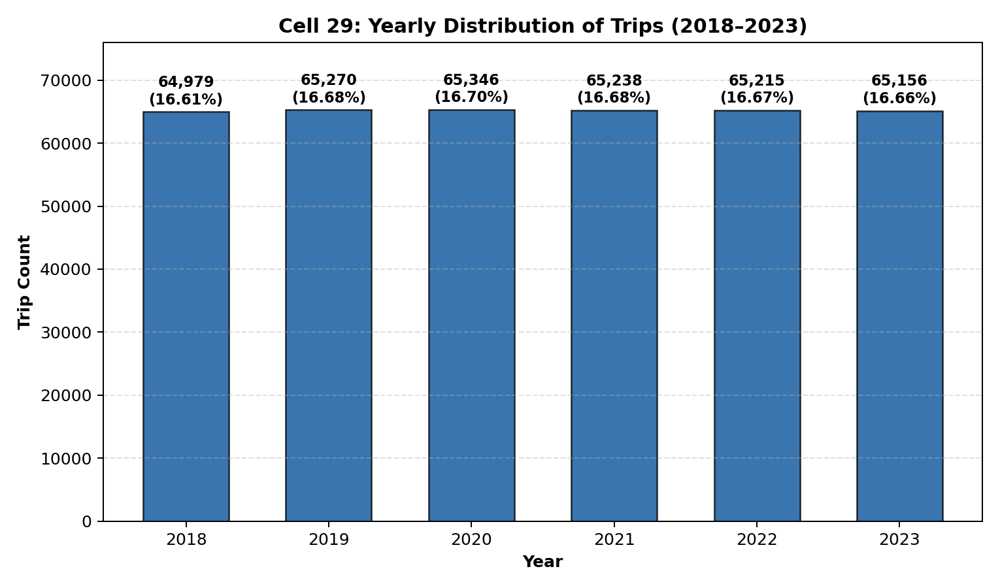

- **Uniform Annual Trip Volume (`2018–2023`)**: `2018` (`64,979`, `16.61%`), `2019` (`65,270`, `16.68%`), `2020` (`65,346`, `16.70%`), `2021` (`65,238`, `16.68%`), `2022` (`65,215`, `16.67%`), `2023` (`65,156`, `16.66%`).
- **Geographic Distribution (`Country` and `Region`)**: `Region` is 100% constant (`"Europe"`), while `Country` is uniformly distributed across **France** (`52,022`, `13.30%`), **Netherlands** (`50,874`, `13.00%`), **Italy** (`50,124`, `12.81%`), **Sweden** (`49,085`, `12.55%`), **Germany** (`47,928`, `12.25%`), **Belgium** (`47,529`, `12.15%`), **Poland** (`47,463`, `12.13%`), and **Spain** (`46,179`, `11.80%`).

## 3. Baseline Machine Learning Model Strategy and Exact Performance Benchmarks

### Step-by-Step Guide to Creating the Baseline Model

1. **Step 1 — Prevent Data Leakage (`Critical Gate`)**: Exclude `manufacturer`, `Model`, `Group`, `wmi`, `plant`, and `Serial Number` (which deterministically encode `Make_n_Model`), and drop constant `Region`.
2. **Step 2 — Engineer Physical Telemetry Ratios**: Create `avg_speed_kmh = total_distance / (trip_duration / 3600)`, `fuel_efficiency_km_per_l = total_distance / total_fuel`, `fuel_consumption_l_per_100km = (total_fuel / total_distance) * 100`, `fuel_burn_rate_l_per_hr = total_fuel / (trip_duration / 3600)`, `trip_span_days`, `trip_month`, and `trip_dayofweek`.
3. **Step 3 — Stratified Train/Test Split (`80% Train / 20% Test`)**: Split `391,204` rows into `312,963` training rows and `78,241` test rows using `train_test_split(X, y, test_size=0.20, stratify=y, random_state=42)`.
4. **Step 4 — Preprocessing via `ColumnTransformer`**: Apply `SimpleImputer(strategy='median')` + `StandardScaler()` to numerical features and `SimpleImputer(strategy='most_frequent')` + `OneHotEncoder(handle_unknown='ignore')` to `special_need` and `Country`.
5. **Step 5 — Benchmark Across Feature Tiers**:

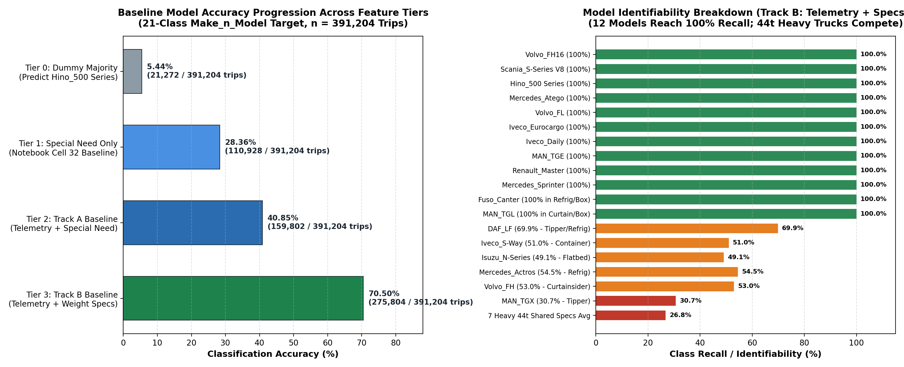


## 4. Feature Engineering and Preprocessing Pipeline

All transformations are encapsulated inside a reusable scikit-learn `Pipeline` (`preprocessor`) so that derived ratios and scaling parameters are computed without data leakage:

### 4.1. Raw Input Features (8 Columns)

| Feature Name | Type | Description |
| :--- | :--- | :--- |
| `trip_duration` | Numeric (`int64`) | Total trip duration in seconds |
| `total_distance` | Numeric (`float64`) | Total trip distance in kilometres |
| `total_fuel` | Numeric (`float64`) | Total fuel consumed in litres |
| `axle_weight_average` | Numeric (`int64`) | Average load per axle in kg |
| `Capacity` | Numeric (`float64`) | Maximum cargo payload capacity in tonnes (`1.5` to `40.0`) |
| `GCW` | Numeric (`float64`) | Gross Combination Weight (vehicle + trailer + load) in tonnes |
| `GVW` | Numeric (`float64`) | Gross Vehicle Weight rating in tonnes |
| `special_need` | Categorical (`object`) | 10 specialized body/application types |

### 4.2. In-Pipeline Derived Features (`FunctionTransformer`)

A custom `add_derived_features` function computes three domain-specific operational metrics before column scaling:

* `trip_duration_hours = trip_duration / 3600` (converts seconds to hours).
* `fuel_per_km = total_fuel / total_distance` (litres per km, guarded via `np.where(total_distance > 0, ..., np.nan)`).
* `avg_speed_kmph = total_distance / trip_duration_hours` (average speed in km/h, guarded via `np.where(trip_duration_hours > 0, ..., np.nan)`).

### 4.3. Column Transformation (`ColumnTransformer`)

* **Numeric Pipeline (`10` features: 7 raw + 3 derived)**: Standardized to zero mean and unit variance via `StandardScaler()`.
* **Categorical Pipeline (`1` feature: `special_need`)**: Encoded into 10 binary indicator columns via `OneHotEncoder(handle_unknown='ignore')`.
* **Transformed Feature Matrix Shape**: `(312963, 20)` for training and `(78241, 20)` for testing.

## 5. Baseline Model Benchmark Results

Four baseline classifiers were trained and evaluated on the 20-feature preprocessed space using weighted multiclass metrics and One-vs-Rest (OvR) ROC-AUC:

| Model | Configuration | Train Time (s) | Train Accuracy | Test Accuracy | Weighted Precision | Weighted F1 Score | Weighted ROC-AUC (OvR) |
| :--- | :--- | ---: | ---: | ---: | ---: | ---: | ---: |
| **Logistic Regression** | `max_iter=1000` | 185.70 | 0.7192 | **0.7168** | **0.7619** | **0.7049** | **0.9615** |
| **Decision Tree** | Default (`unconstrained`) | 10.14 | 1.0000 | 0.7037 | 0.7037 | 0.7037 | 0.8439 |
| **SVM (Linear)** | `kernel='linear'` | 2,002.49 | 0.7191 | 0.7166 | 0.7260 | 0.6972 | NaN |
| **K-Nearest Neighbors** | `n_neighbors=5` | **1.26** | 0.7884 | 0.6781 | 0.6803 | 0.6768 | 0.9083 |

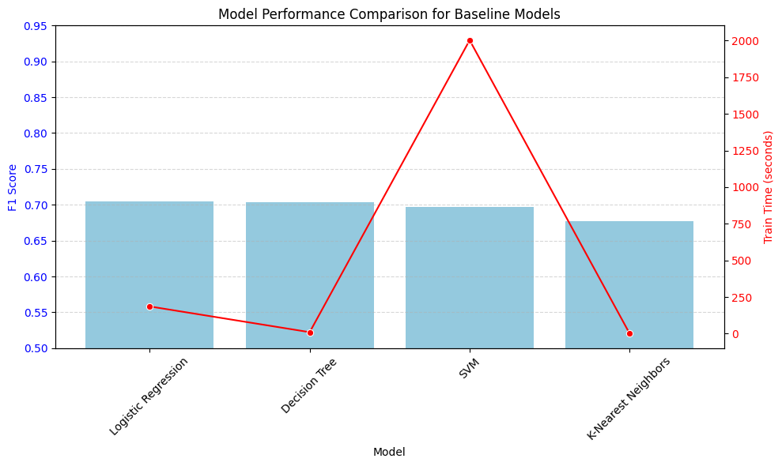

### 5.1. Key Benchmark Takeaways

* **Baseline Champion — Logistic Regression**: Achieved the highest test accuracy (**71.68%**), weighted precision (**76.19%**), weighted F1 score (**0.7049**, macro F1 **0.7237**), and multiclass OvR ROC-AUC (**0.9615**), with virtually zero overfitting (`0.7192` train vs. `0.7168` test).
* **Decision Tree Overfitting**: Memorized the training set (`1.0000` train accuracy) but dropped to `0.7037` test accuracy and `0.8439` ROC-AUC due to unconstrained depth fitting noise in overlapping continuous telemetry features.
* **Linear SVM Computational Bottleneck**: Required **2,002.49 seconds (~33.4 minutes)** to converge on 312,963 rows while matching Logistic Regression's linear decision boundary (`0.7166` test accuracy, `0.6972` F1) and lacking probability estimates (`probability=False` by default, yielding `NaN` for ROC-AUC).
* **KNN Local Sensitivity**: Fast fit time (`1.26 s`) but lowest test accuracy (`0.6781`) and F1 (`0.6768`), reflecting distortion of Euclidean distances by redundant collinear trip-length features.

## 6. Diagnostic Per-Class Performance (Logistic Regression)

### 6.1. Full 21-Class Classification Report and OvR ROC-AUC Breakdown

Evaluating Logistic Regression on the 78,241 test samples reveals exact class-by-class precision, recall, F1, support, and One-vs-Rest ROC-AUC:

| Target Class (`Make_n_Model`) | Precision | Recall | F1-Score | Test Support | OvR ROC-AUC | Diagnostic Regime |
| :--- | ---: | ---: | ---: | ---: | ---: | :--- |
| `DAF_LF` | 1.0000 | 1.0000 | 1.0000 | 3,514 | 1.000 | Perfectly Separable |
| `DAF_XG+` | 0.2009 | 0.1439 | 0.1677 | 4,093 | 0.882 | 44t Heavy-Duty Cluster |
| `Fuso_Canter` | 0.6715 | 1.0000 | 0.8035 | 3,788 | 0.994 | Light-Duty Pair Overlap |
| `Hino_500 Series` | 1.0000 | 1.0000 | 1.0000 | 4,256 | 1.000 | Perfectly Separable |
| `Isuzu_N-Series` | 1.0000 | 0.4888 | 0.6567 | 3,625 | 0.993 | Light-Duty Pair Overlap |
| `Iveco_Daily` | 1.0000 | 1.0000 | 1.0000 | 3,439 | 1.000 | Perfectly Separable |
| `Iveco_Eurocargo` | 1.0000 | 1.0000 | 1.0000 | 3,266 | 1.000 | Perfectly Separable |
| `Iveco_S-Way` | 0.5943 | 0.5142 | 0.5514 | 3,769 | 0.953 | 44t Heavy-Duty Cluster |
| `MAN_TGE` | 1.0000 | 1.0000 | 1.0000 | 3,821 | 1.000 | Perfectly Separable |
| `MAN_TGL` | 1.0000 | 1.0000 | 1.0000 | 3,794 | 1.000 | Perfectly Separable |
| `MAN_TGX` | 1.0000 | 0.3069 | 0.4696 | 3,966 | 0.912 | 44t Heavy-Duty Cluster |
| `Mercedes_Actros` | 0.2093 | 0.4128 | 0.2778 | 4,184 | 0.883 | 44t Heavy-Duty Cluster |
| `Mercedes_Atego` | 1.0000 | 1.0000 | 1.0000 | 4,055 | 1.000 | Perfectly Separable |
| `Mercedes_Sprinter` | 1.0000 | 1.0000 | 1.0000 | 2,076 | 1.000 | Perfectly Separable |
| `Renault_Master` | 1.0000 | 1.0000 | 1.0000 | 3,503 | 1.000 | Perfectly Separable |
| `Renault_T High` | 0.5000 | 0.0013 | 0.0025 | 3,939 | 0.875 | 44t Heavy-Duty Cluster |
| `Scania_R-Series` | 0.0000 | 0.0000 | 0.0000 | 4,005 | 0.886 | 44t Heavy-Duty Cluster |
| `Scania_S-Series V8` | 1.0000 | 1.0000 | 1.0000 | 3,384 | 1.000 | Perfectly Separable |
| `Volvo_FH` | 0.1781 | 0.5453 | 0.2685 | 4,020 | 0.872 | 44t Heavy-Duty Cluster |
| `Volvo_FH16` | 1.0000 | 1.0000 | 1.0000 | 4,058 | 1.000 | Perfectly Separable |
| `Volvo_FL` | 1.0000 | 1.0000 | 1.0000 | 3,686 | 1.000 | Perfectly Separable |
| **Accuracy** | | | **0.7168** | **78,241** | | |
| **Macro Avg** | **0.7788** | **0.7340** | **0.7237** | **78,241** | | |
| **Weighted Avg** | **0.7619** | **0.7168** | **0.7049** | **78,241** | **0.9615** | |

### 6.2. Confusion Matrix and Multiclass ROC-AUC Visual Analysis

* **12 Perfectly Separable Classes (`F1 = 1.0000`, `AUC = 1.000`)**: Form clean diagonal blocks on the confusion matrix because their `(Capacity, GCW, GVW, special_need)` combinations are unique.
* **Light-Duty Pair (`Fuso_Canter` vs. `Isuzu_N-Series`)**: Half of `Isuzu_N-Series` test instances (`51.1%`) are predicted as `Fuso_Canter`, yielding `1.0000` recall for `Fuso_Canter` and `1.0000` precision for `Isuzu_N-Series` (`AUC = 0.994` and `0.993`).
* **44-Tonne Tractor Cluster (`DAF_XG+`, `Iveco_S-Way`, `MAN_TGX`, `Mercedes_Actros`, `Renault_T High`, `Scania_R-Series`, `Volvo_FH`)**: Because all seven models share `GCW = 44.0`, `GVW = 26.0`, and `Capacity = 24.0`, off-diagonal confusion concentrates heavily into `Volvo_FH`, `Mercedes_Actros`, and `DAF_XG+`. Even so, their OvR ROC-AUC scores remain between **0.872 and 0.953**, confirming strong rank-ordering within the 44t tier relative to the other 14 classes.

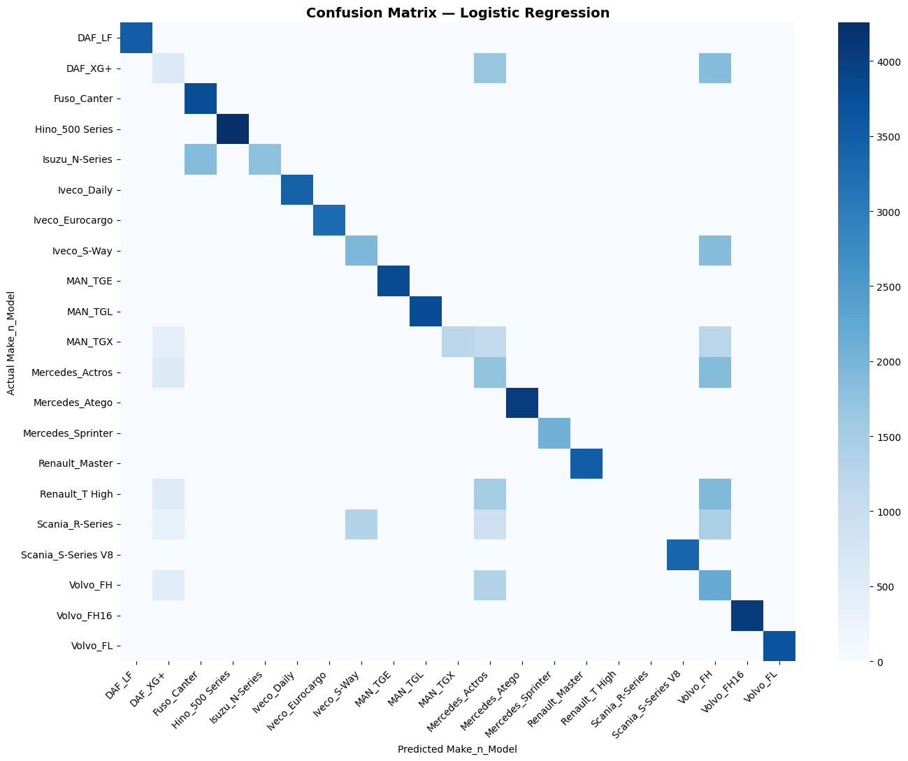

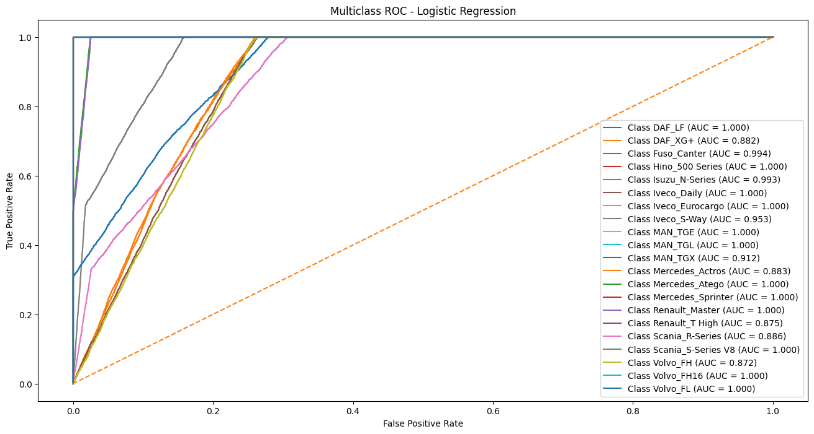

## 7. Saved Model Artifact and Usage

The winning Logistic Regression baseline pipeline is serialized with `joblib` for downstream comparison and inference:

* **Artifact Path**: `baseline_fleet_classifier_pipeline.joblib`

```python
import joblib
import pandas as pd

# Load end-to-end preprocessing + Logistic Regression pipeline
baseline_package = joblib.load("baseline_fleet_classifier_pipeline.joblib") 

```

## 8.Next Steps for Model Improvement

1. **Resolve Feature Collinearity**: Drop raw `trip_duration` (which has $r = 1.000$ with `trip_duration_hours`) and test pruning redundant raw scale features (`total_distance`, `total_fuel`) in favor of `fuel_per_km`, `avg_speed_kmph`, and `trip_duration_hours`.
2. **Stratified Splitting**: Add `stratify=y` to `train_test_split` to guarantee exact class proportions across train and test sets.
3.  **Model Evaluation**: Next step to evaluating baseline performance across standard algorithms, compares the same, We do hyperparameter tunnign is done via `RandomizedSearchCV` for 
    1. **Logistic Regression** (Linear Baseline)
    2. **K-Nearest Neighbors (KNN)** (Instance-based learning)
    3. **Decision Tree Classifier** (Tree Baseline)
    4. **Support Vector Machine (SVM)** (Maximum Margin Classification)
    5. **Random Forest Classifier** (Ensemble Benchmark)

#### Outline of project

- [Link to notebook](code/Capstone_project_EDASubmission_Module20_WithBaseline.ipynb)


##### Contact and Further Information

Rajeev Batra
