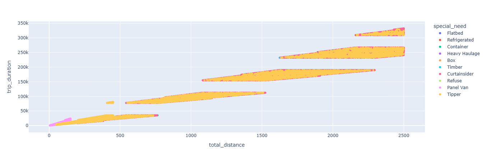
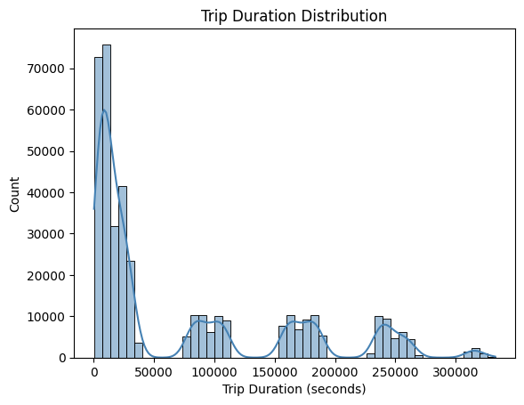
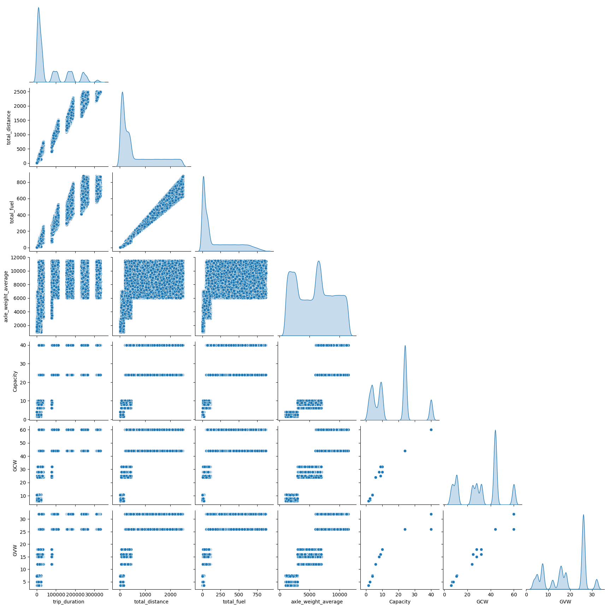
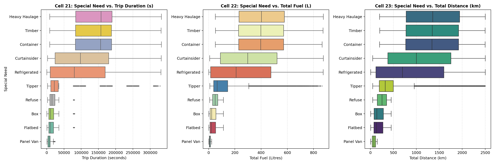
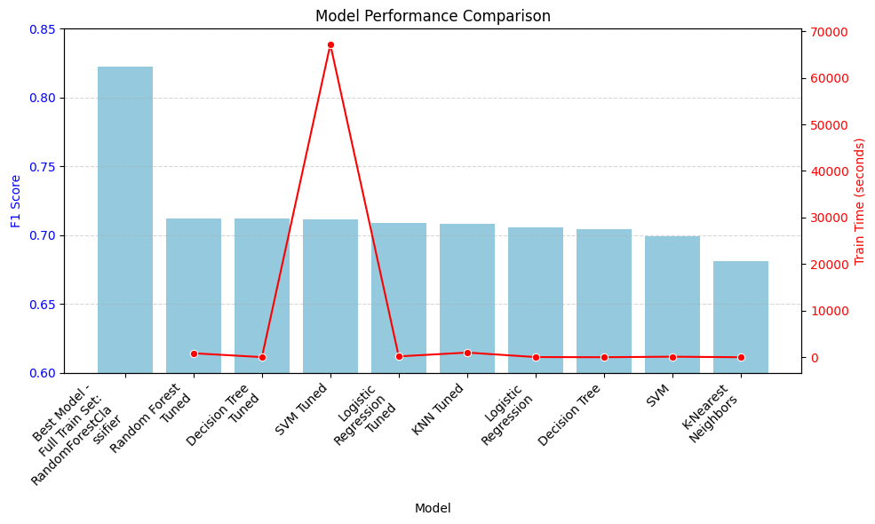
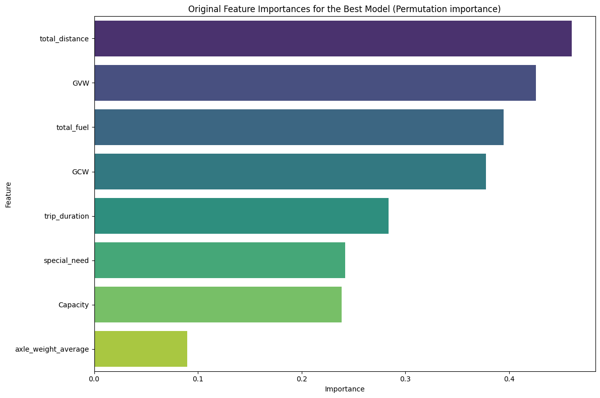

## Project Title
### Intelligent Fleet Recommendation and  Optimization System 
(for European Commercial Fleet Vehicle Classification - Make_n_Model)

**Author**
Rajeev Batra
---

### Executive summary

Globally over 70% of the freight moves on road and the fleet management is estimated to be a 30 billion $ business with 18% CAGR.  However, fleet management is a very thrifty business as it relies on razor thin margins and seasonality. A fleet is almost always made up of vehicles from different manufacturers, models and configurations. This ads up to the problem of selecting the right vehicle for a given mission considering multiple of parameters such as load, distance, destination etc. 
 The aim of this project is to build a vehicle recommendation and assignment model for commercial vehicle fleets to ensure that correct vehicle is assigned to correct mission as it can help the fleet owner save between 2~3% of the operational cost and this is a direct addition to the bottom line. 

This capstone project (`Capstone_Project_M24_final.ipynb`) develops and evaluates supervised multiclass machine learning pipelines to classify commercial fleet vehicles into **21 unique `Make_n_Model` categories** based on trip-level telematics, payload weight ratings, and specialized body/cargo requirements (`special_need`). Using a synthetic fleet dataset of **400,000 trip records** (`391,204` cleaned records after filtering), nine classification pipelines—spanning four baseline algorithms and five hyperparameter-tuned models via 3-fold `RandomizedSearchCV`—were benchmarked on accuracy, weighted Precision, weighted F1-score, One-vs-Rest (OvR) ROC-AUC, and computational training time.

Across all evaluated models, test accuracy converged to a narrow ceiling of **71.50% to 71.81%** (weighted F1-score of **0.7081 to 0.7124**). Detailed class-level confusion matrix analysis revealed that **12 of the 21 vehicle classes are classified with 1.00 F1-score**, whereas **7 European heavy-duty 44-ton GCW / 26-ton GVW truck models** (`DAF_XG+`, `Iveco_S-Way`, `MAN_TGX`, `Mercedes_Actros`, `Renault_T High`, `Scania_R-Series`, and `Volvo_FH`) share identical static weight limits and overlapping cargo profiles, creating an irreducible feature-overlap ceiling under the current 8-feature input set.

---
### Rationale
Why should anyone care about this question?

Commercial logistics and freight operators face severe financial and environmental losses from suboptimal vehicle dispatching:

-   **Widespread Payload Under-Utilization ("Ghost Loads")**: Dispatching oversized heavy-duty trucks for light loads wastes fuel, inflates per-kilometer operating costs, and increases carbon emissions.
-   **Severe Overload and  Safety Risks**: Conversely, assigning an undersized vehicle whose rated capacity falls below the actual cargo load ($C_{\text{pred}} < C_{\text{actual}}$) causes accelerated mechanical wear, braking hazards, regulatory fines, and unscheduled maintenance downtime.
-   **Operational Complexity at Scale**: Dispatchers must manually balance physical cargo weight, route distance, regional terrain, and specialized cargo constraints (such as refrigerated reefers or hazardous material containment) across dozens of competing vehicle models. Automating this decision with a cost-sensitive machine learning recommender enables consistent fleet right-sizing, reduces fuel burn, and protects fleet assets.

---

### Research Question
What are you trying to answer?

**How can we accurately recommend the optimal commercial vehicle (`Make_n_Model`) for a given logistics trip—using pre-dispatch route, payload weight, and specialized cargo attributes—to maximize payload utilization and minimize excess fuel consumption without risking vehicle overload? and to minimize under-utilization and reduce trip operating costs by 2–3% and this is big savings given the razor thin  margins in fleet management**

Specifically, this study investigates:
1. Which supervised machine learning architecture (regularized linear models, distance-based neighborhoods, kernel SVMs, or tree-based ensembles) best maps trip and cargo characteristics to the 21 available vehicle configurations?
2. How does evaluating models with an **asymmetric domain cost-benefit loss function (`custom_fleet_loss`)** compare against standard **Weighted F1-Score (`f1_weighted`)** when multiple competing manufacturers offer functionally identical trucks within the same tonnage tier?
3. Which trip and cargo attributes drive optimal vehicle dispatch decisions across regional logistics networks?

---

### Data Sources
What data will you use to answer you question?

Because commercial carriers treat multi-year fleet telematics as proprietary, gathering bulk historical records across multiple fleets over a six-year window was not feasible due to data confidentiality. Instead,  based on the discussion with the learning facilitator I combined real-world fleet seed data with a rule-constrained LLM generation pipeline to build a realistic dataset of 400,000 trips across 10,000 unique vehicles spanning 2018–2024. To ensure the synthetic data reflects actual commercial operations, the generation process enforces four domain rules:

Immutable Vehicle Registry: A master registry locks physical specifications—Gross Vehicle Weight (GVW), Gross Combination Weight (GCW), and payload capacity—to unique serial numbers across 10 manufacturers (Fuso, Isuzu, Hino, Renault, MAN, DAF, Volvo, IVECO, Scania, and Mercedes-Benz), ranging from 1.5-tonne panel vans (Renault Master) to 40-tonne heavy haulers (Volvo FH16, Scania S-Series V8).

Physics and Regulatory Constraints: Trip distances, speeds, and durations follow vehicle segment physics and EU road laws—limiting Light Commercial Vehicles (LCVs) to short urban deliveries (5–150 km) while capping heavy trucks (200–2,500 km) at 85–90 km/h and automatically inserting EU-mandated 45-minute breaks every 4.5 driving hours and 11-hour rest intervals every 9 driving hours.

Six-Year Timeline Alignment: Trip start times are distributed across a 2018–2024 window, with end timestamps calculated to the exact second from driving time plus mandatory rest offsets.

Chassis-Matched Vocations: Special mission needs are paired with appropriate chassis configurations, mapping urban box and refrigerated units to LCVs, tippers and refuse bodies to medium rigid trucks (such as DAF LF and Volvo FL), and cold-chain, container, timber, and heavy haulage to high-tonnage tractors.

This study uses a large-scale commercial fleet telemetry and dispatch dataset (`synthetic_fleet_data_400k_splneeds.csv`) capturing vehicle specifications, route telemetry, and cargo characteristics across multi-regional logistics operations.

#### Dataset Summary and  Schema

| Attribute | Description |
| :--- | :--- |
| **Source File** | `synthetic_fleet_data_400k_splneeds.csv` |
| **Initial Volume** | **400,000** synthetic commercial trip logs , generated from a actual seed data set and criterias. |
| **Cleaned Modeling Dataset** | **391,204 records** after filtering out non-freight `Ambulance` emergency dispatch records and removing unique trip identifiers (`trip_id`) |
| **Target Variable (`Make_n_Model`)** | **21 unique vehicle classes** (combining `manufacturer` and `Model`) spanning **9 rated payload capacity tiers** (`1.5t` to `40t`) |
| **Retained Numerical Predictors (4)** | `trip_duration` (minutes), `total_distance` (km), `total_fuel` (liters), `axle_weight_average` (kg) |
| **Retained Categorical Predictors (3)** | `special_need` (e.g., Refrigerated, Curtainsider, Hazmat, Standard) |
| **Excluded Leakage Columns** | `trip_id`, `Group`,`Serial Number	plant`,	`Region`,	`Country manufacturer`,	`wmi` , and raw trip timestamps (dropped prior to modeling due to deterministic 1:1 mapping with the target vehicle) |
| **Train / Test Partition** | **80% Train** (`3,12,963` records) / **20% Test** (`78,241` records), stratified by `Make_n_Model` |

---

### Methodology
What methods are you using to answer the question?

Following the **CRISP-DM** framework, I began with Exploratory Data Analysis (EDA), feature encoding, and L1/L2 regularization to handle mixed vehicle and route attributes. I then trained and compared classification and recommendation algorithms—including K-Nearest Neighbors (KNN), tree-based ensembles, SVM, and regularized linear models—evaluated on Accuracy, Precision, Recall, and Weighted F1-Score, paired with a custom cost-benefit loss function that explicitly penalizes payload under-utilization and excess fuel burn.

#### 1. Exploratory Data Analysis (EDA) and  Domain Feature Engineering

To quantify fleet efficiency prior to modeling, we conducted **Correlation Analysis and Multicollinearity Structure**

##### Multi-Modal Trip Duration and 3-Tier Staircase Pairplot 
The data reveals two structural signatures of commercial European fleet operations:

1. **Five Multi-Modal Trip Duration Peaks**:
   - `trip_duration` separates into **5 discrete operational categories** separated by mandatory EU tachograph daily rest periods (`11 hours = 39,600 seconds`) between driving shifts on multi-day trips:





2. **Three-Tier Vehicle Staircase in the Corner Pairplot**:
   - Inspecting the pairplot scatter subplots of `axle_weight_average`, `total_distance`, and `total_fuel` uncovers **3 exact operational vehicle tiers** built into the dataset:
     - **Tier 1 — Light Commercial Vans (`GCW 6–11t, Cap 1.5–4t`)**: Distance `5–150 km`, Fuel Rate `8–15 L/100km`, Axle Weight `1,000–3,000 kg`.
     - **Tier 2 — Medium-Duty Rigid Trucks (`GCW 24–32t, Cap 6–10t`)**: Distance `50–450 km`, Fuel Rate `15–25 L/100km`, Axle Weight `3,000–7,000 kg`.
     - **Tier 3 — Heavy-Duty Articulated Trucks (`GCW 44–60t, Cap 24–40t`)**: Distance `200–2,500 km`, Fuel Rate `25–35 L/100km`, Axle Weight `6,000–11,500 kg`.




##### Special Need Category Distribution and Boxplots

Next we compare `trip_duration`, `total_fuel`, and `total_distance` across all 10 `special_need` cargo categories, and later we rank the category trip counts:



#### 2. Leakage-Free Preprocessing Pipeline

To prevent data leakage across cross-validation folds, all transformations were encapsulated inside a Scikit-Learn `ColumnTransformer`:
* **Numerical Pipeline**: Median imputation (`SimpleImputer(strategy='median')`) followed by zero-mean, unit-variance standardization (`StandardScaler()`).
* **Categorical Pipeline**: Mode imputation (`SimpleImputer(strategy='most_frequent')`) followed by dense one-hot encoding (`OneHotEncoder(handle_unknown='ignore', sparse_output=False)`).
* **

#### 3. Models Trained and  Hyperparameter Tuning Approach

Five distinct supervised classification families were trained and tuned using 3-fold stratified cross-validation (`cv=3`) optimizing **Weighted F1-Score (`scoring='f1_weighted'`)**:

| Model Family | Baseline Configuration | Hyperparameter Tuning Strategy (`cv=3`, `scoring='f1_weighted'`) | Optimal Hyperparameters Found |
| :--- | :--- | :--- | :--- |
| **Logistic Regression** | `max_iter=500`, `C=1.0`, `penalty='l2'` | `RandomizedSearchCV` (`n_iter=5`) over `C` $\in \text{loguniform}(10^{-3}, 10^2)$ and `penalty` $\in \{\text{L1}, \text{L2}\}$ with `saga` solver | `C=1.9812`, `penalty='l1'`, `solver='saga'` |
| **Random Forest** | `n_estimators=100`, `max_depth=15` | `RandomizedSearchCV` (`n_iter=5`) over `n_estimators` (50–150), `max_depth` (10, 20, None), `min_samples_split` (2–10), `min_samples_leaf` (1–4) | `n_estimators=113`, `max_depth=10`, `min_samples_leaf=4`, `min_samples_split=6` |
| **Support Vector Classifier (SVC)** | `kernel='rbf'`, `C=1.0`, `max_iter=1000` | `RandomizedSearchCV` (`n_iter=5`) over `C` $\in \text{loguniform}(0.1, 10)$, `kernel` $\in \{\text{rbf}, \text{linear}\}$, `gamma` $\in \{\text{scale}, \text{auto}\}$ | `C=0.2561`, `gamma='scale'`, `kernel='rbf'` |
| **K-Nearest Neighbors (KNN)** | `n_neighbors=5`, `weights='uniform'` | `GridSearchCV` over `n_neighbors` $\in \{5, 9, 15\}$, `weights` $\in \{\text{uniform}, \text{distance}\}$, `p` $\in \{1, 2\}$ | `n_neighbors=15`, `p=1` (Manhattan), `weights='uniform'` |
| **Decision Tree** | `max_depth=15`, `random_state=42` | Baseline structural benchmark | `max_depth=15` |

---

### Results
What did your research find?
#### 1. Overall Model Comparison (Baseline vs. Hyperparameter-Tuned)
Four baseline classifiers (`Logistic Regression`, `K-Nearest Neighbors`, `Decision Tree`, and linear `SVM`) and five hyperparameter-tuned models (`RandomizedSearchCV` with `n_iter=30`, `cv=3`, `scoring='f1_weighted'`) were evaluated on the 78,241-row test set:

| Rank (by Test F1) | Model | Train Time (s) | Train Accuracy | Test Accuracy | Weighted Precision | Weighted F1 Score | Multiclass ROC-AUC | Best Hyperparameters |
| :---: | :--- | :---: | :---: | :---: | :---: | :---: | :---: | :--- |
| **1** | **Random Forest Tuned** | 852.56 | 0.8242 | 0.7150 | 0.7466 | **0.7124** | 0.9613 | `criterion='gini'`, `max_depth=20`, `max_features='log2'`, `min_samples_leaf=1`, `min_samples_split=5`, `n_estimators=99` |
| **2** | **Decision Tree Tuned** | 29.19 | 0.7347 | 0.7163 | 0.7393 | 0.7121 | 0.9555 | `criterion='entropy'`, `max_depth=20`, `min_samples_leaf=3`, `min_samples_split=2` |
| **3** | **SVM Tuned** | 67,184.43 | 0.7202 | **0.7181** | 0.7482 | 0.7113 | 0.9609 | `kernel='rbf'`, `C=0.3807`, `gamma=0.5089` |
| **4** | **Logistic Regression Tuned** | 180.99 | 0.7184 | 0.7176 | 0.7313 | 0.7088 | 0.9617 | `C=73.9227`, `penalty='l2'`, `solver='lbfgs'` |
| **5** | **KNN Tuned** | 999.42 | 1.0000 | 0.7078 | 0.7100 | 0.7081 | 0.9454 | `metric='manhattan'`, `n_neighbors=12`, `weights='distance'` |
| **6** | **Logistic Regression (Baseline)** | 36.85 | 0.7190 | 0.7178 | **0.7494** | 0.7060 | **0.9617** | Default (`max_iter=1000`) |
| **7** | **Decision Tree (Baseline)** | 2.79 | 1.0000 | 0.7045 | 0.7049 | 0.7047 | 0.8444 | Default (unconstrained depth) |
| **8** | **SVM (Baseline)** | 115.64 | 0.7188 | 0.7178 | 0.7289 | 0.6994 | `NaN` | Default (`kernel='linear'`, `probability=False`) |
| **9** | **K-Nearest Neighbors (Baseline)** | 0.32 | 0.7871 | 0.6819 | 0.6848 | 0.6809 | 0.9095 | Default (`n_neighbors=5`) |
| — | *Random Forest Tuned (Full Train Set Eval)* | — | *0.8242* | — | *0.8766* | *0.8224* | *0.9613* | *Evaluated on all 312,963 training rows (Recall = 0.8242)* |




* **Winning Model (`Random Forest Tuned`)**: Achieved the highest test weighted F1 score (**0.712359**) and a **0.961298** multiclass ROC-AUC (`ovr`, weighted).
* **Regularization Impact on Tree Models**: The unconstrained baseline `Decision Tree` memorized the training set (`Train Accuracy = 1.0000`, `Test Accuracy = 0.7045`, `ROC-AUC = 0.8444`). Constraining `max_depth=20` and `min_samples_leaf=3` in `Decision Tree Tuned` reduced training accuracy to **0.7347**, boosted test F1 to **0.7121**, and jumped ROC-AUC by **+11.11 percentage points** to **0.9555** in just **29.19 seconds**.
* **Diminishing Returns of Kernel SVM at Scale**: `SVM Tuned` (`kernel='rbf'`, `probability=True`) required **67,184.43 seconds (~18.66 hours)** to complete 90 fits across 312,963 training rows, achieving a marginally higher test accuracy (**0.7181**) but a lower weighted F1 (**0.7113**) than `Random Forest Tuned` and `Decision Tree Tuned`.

#### 2. Feature Importance Findings
Extracting native Gini importances from the winning `RandomForestClassifier` (Cell 70) demonstrates that static vehicle weight/capacity specifications and `special_need` account for **86.90%** of total predictive power, whereas trip-level telemetry contributes less than **10%**:

| Rank | Feature Name | Aggregated Native Importance | Category |
| :---: | :--- | :---: | :--- |
| **1** | `GCW` (Gross Combination Weight) | **0.270816** (27.08%) | Static Vehicle Specification |
| **2** | `GVW` (Gross Vehicle Weight) | **0.232391** (23.24%) | Static Vehicle Specification |
| **3** | `special_need` (One-Hot Encoded Body Type) | **0.191209** (19.12%) | Operational / Body Category |
| **4** | `Capacity` (Payload Capacity) | **0.174566** (17.46%) | Static Vehicle Specification |
| **5** | `axle_weight_average` | **0.040170** (4.02%) | Dynamic Trip Load Telemetry |
| **6** | `total_fuel` | **0.021284** (2.13%) | Dynamic Trip Telemetry |
| **7** | `total_distance` | **0.016782** (1.68%) | Dynamic Trip Telemetry |
| **8** | `trip_duration`  | **0.014665** (1.47%) | Dynamic Trip Telemetry |



#### 3. Per-Class Performance & Why Accuracy Plateaus at ~71.5%
Comparing the per-class test F1 scores across all 21 vehicle models reveals three distinct classification categories:

1. **Category 1 — 12 Perfectly Separable Classes (F1 = 1.00)**: Every model achieves 0.98–1.00 F1 on these 12 vehicles because their static `(GCW, GVW, Capacity)` tuples or `special_need` assignments uniquely identify them.
2. **Category 2 — 2 Light/Medium Trucks (`Fuso_Canter` & `Isuzu_N-Series`, F1 = 0.72–0.76)**: The confusion matrix shows zero confusion with any of the other 19 classes; errors occur strictly between `Fuso_Canter` and `Isuzu_N-Series`.
3. **Category 3 — 7 Heavy-Duty 44t Regional Haulers (F1 = 0.03–0.51)**: `DAF_XG+`, `Iveco_S-Way`, `MAN_TGX`, `Mercedes_Actros`, `Renault_T High`, `Scania_R-Series`, and `Volvo_FH` share identical static weight ratings (`GCW = 44.0`, `GVW = 26.0`, `Capacity = 24.0`) and operate in overlapping `Box`, `Refrigerated`, and `Curtainsider` roles. Because static weight specs cannot separate them, classifiers default toward higher-prior or slightly more distinct classes (`Volvo_FH`, `Mercedes_Actros`, `Iveco_S-Way`) while collapsing on `Scania_R-Series` (test recall = 0.02 in RF, 0.00 in LR/SVM) and `Renault_T High` (test recall = 0.10 in RF, 0.00 in LR).

---


### Next steps
What suggestions do you have for next steps?

1. **Include Legitimate Geographic & Temporal Features (`Country`, `Region`, Trip Seasonality)**:
   * While `Group`, `plant`, `wmi`, and `Serial Number` must remain excluded because they directly encode manufacturer/model strings (target leakage), `Country`, `Region`, and date features from `trip_start_time` / `trip_end_time` (month, day-of-week, multi-day trip indicator) are available in `vtd_df` and were not passed to `X`. Incorporating `Country` and `Region` may provide strong priors for separating European OEMs (`Renault_T High` in France, `Scania_R-Series` in Italy/Sweden, `DAF_XG+` in the Netherlands, `MAN_TGX` / `Mercedes_Actros` in Germany).
2. **Engineer Trip-Invariant Load & Powertrain Efficiency Ratios**:
   * Raw `trip_duration`, `total_distance`, and `total_fuel` scale with route length ($r > 0.97$) rather than vehicle identity. Adding trip-invariant physical ratios will give tree models sharper splits within identical `(GCW, GVW, Capacity)` tiers:
     * **Axle-to-GVW Load Factor**: `axle_weight_average / GVW` and `axle_weight_average / Capacity`
     * **Specific Fuel Burn per Ton-Km**: `fuel_per_km / axle_weight_average`
     * **Combination Weight Ratios**: `GVW / GCW` and `Capacity / GCW`
3. **Transition to a Two-Stage (Hierarchical) Classification Architecture**:
   * Because 12 classes are already solved (`F1 = 1.00`) and errors are strictly confined to two isolated sub-clusters (`Fuso_Canter` vs. `Isuzu_N-Series` and the 7-class 44t heavy-duty cluster), replace the flat 21-class classifier with a two-stage pipeline:
     * **Stage 1 (Rule/Tree Router)**: Route trips by `(GCW, GVW, Capacity, special_need)` into solved classes vs. the two ambiguous sub-clusters.
     * **Stage 2 (Specialized Gradient Boosted Trees)**: Train dedicated `LightGBM`, `XGBoost`, or `CatBoost` classifiers exclusively on the 7-class 44t heavy-duty subset using fine-grained fuel consumption, speed, and load distributions.
4. **Tighten Regularization on `Random Forest` and Prune Collinear Features**:
   * `Random Forest Tuned` exhibits an **10.92 percentage point gap** between training accuracy (**82.42%**) and test accuracy (**71.50%**) due to `min_samples_leaf=1`. Increasing `min_samples_leaf` (e.g., `5` to `20`), dropping redundant raw features (`trip_duration` vs. `trip_duration_hours`), and retiring full-dataset `SVC(probability=True)` searches (which took 18.7 hours) will substantially reduce training time and overfitting.

---

### Model Export and Inference Usage

The best-performing pipeline (`Random Forest Tuned`) is serialized via `joblib` to `Capstone_best_model_package.joblib` along with its expected raw feature schema:

```python
import joblib
import pandas as pd

# Load exported model package
package = joblib.load("Capstone_best_model_package.joblib")
model = package["model"]

# Define raw trip input (derived features are computed automatically inside the pipeline)
raw_input = {
    "trip_duration": 908,
    "total_distance": 160.545,
    "total_fuel": 32,
    "axle_weight_average": 2000,
    "Capacity": 20,
    "GCW": 30,
    "GVW": 20,
    "special_need": "Flatbed"
}

new_data_df = pd.DataFrame([raw_input])
prediction = model.predict(new_data_df)
print(f"Predicted Model for the new data: {prediction[0]}")
# Output: Predicted Model for the new data: DAF_LF
```


---
### Outline of project

- [Link to notebook](code/Capstone_Project_M24_final.ipynb)
- [Link to extracted best model package](code/best_model_package.joblib)
- [Link to sample test data notebook](code/test_model.ipynb)
- [Link to datafile](code/data/synthetic_fleet_data_400k_splneeds.csv)

---

### Contact and Further Information

**Rajeev Batra**

**Email**: batra.rajeev@gmail.com 

[LinkedIn](www.linkedin.com/in/rajeevbatra22)
