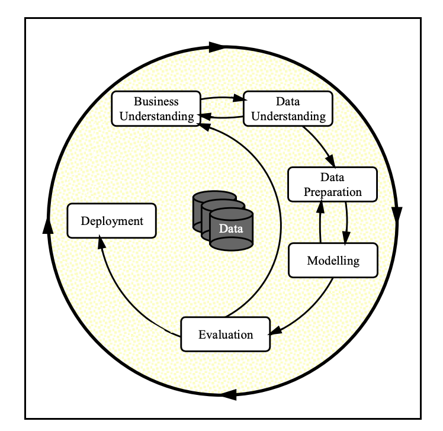

# Practical Application III: Comparing Classifiers

## Overview
This project analyzes a bank marketing dataset from the UCI Machine Learning Repository and compares the performance of four classifiers:
- K Nearest Neighbors
- Logistic Regression
- Decision Trees
- Support Vector Machines

The goal is to predict whether a client will subscribe to a term deposit (`y = yes/no`). The notebook uses the full `bank-additional-full.csv` dataset and evaluates classifiers on training and test splits.

By tracking training time, training accuracy, and test accuracy, we perform a side-by-side benchmarking analysis under baseline, default, and hyperparameter-tuned conditions

## The CRISP-DM Process Framework

  

We follow CRISP DM framework for this project and iterate thru the stages as we conduct EDA, model the data with base configuration of classifier and subsequently do Hypertuning. Subsequently to conduct evaluation and recommendation.

## Dataset
- Source: UCI Machine Learning Repository - Bank Marketing dataset
- File used: `data/bank-additional-full.csv`
- Records: 41,188 examples
- Features include demographic, financial, and campaign-related information such as age, job, marital status, education, credit default, housing loan, and contact type.
- Target: `y` indicating subscription to a term deposit.

## Technical Pipeline
- **Data Ingestion and Exploration**: Loaded using pandas. Handled semi-colon delimiters, inspected dimensions, feature names, data types, and value balances.  
- **Exploratory Data Analysis (EDA)**: Generated dynamic data profiling reports using ydata-profiling (ProfileReport) to locate multicollinearity and anomalies.  
- **Data Preprocessing**:
  - Categorical variable encoding via one-hot/dummy encoding.  
  - Feature engineering/drop rules (e.g., handling the duration column carefully as it explicitly skews predictive validity).  
  - Numerical feature scaling utilizing StandardScaler. 
- **Train/Test Splitting**: Stratified 80/20 train/test division to handle the structural imbalance of the target label.  
- **Baseline Definition**: Established a majority-class classifier showing a baseline test accuracy of 88.65% (predicting no for all instances).  
- **Model Benchmarking**: Fitted default and optimized structures for all four frameworks and visualizes results with a combined bar/line chart

## Model Evaluation Results
### Default Setting Benchmark
Under their default configuration, Logistic Regression delivers the best general test performance while maintaining extremely brief computation times:  
- **Logistic Regression Test Accuracy**: 0.9104 (91.04%)  
- **Characteristics**: Highly efficient training overhead with solid predictive capacity out-of-the-box.  
### Hyperparameter Tuning Classifiers Benchmark
After performing hyperparameter tuning using cross-validated grid search (GridSearchCV), the Decision Tree model outperforms alternative classifiers by establishing an optimal trade-off between performance and computation:  
- **Top Classifier**: Decision Tree Classifier  
- **Optimal Setting**: max_depth = 5  
- **Tuned Test Accuracy**: 0.9151 (91.51%)  
- **Characteristics**: Low training latencies, highly readable and explanatory tree branches, and superior validation performance compared to compute-heavy Support Vector Machines.  

## Key Findings, Recommendations / Next steps
- **Data concern**: The `default` feature contains a large number of `unknown` values, and the `default` column is heavily skewed toward `no`. This may introduce bias into the model and should be investigated further.
- Outlier Filtering: Rerunning the analytics pipeline after clipping continuous socioeconomic features above the 75th percentile to inspect validation score lifts.
- Investigate how `unknown` values in `default` and `loan` should be handled to reduce bias.
- Explore additional classifiers or ensemble methods to improve test accuracy while keeping training time reasonable.
- Consider feature engineering or resampling approaches for imbalanced label distributions.

## How to run
1. Open `prompt_III.ipynb` in Jupyter Notebook or JupyterLab.
2. Ensure the dataset file exists at `data/bank-additional-full.csv`.
3. Execute cells sequentially from top to bottom.

## Notes
- The notebook also includes dataset documentation references and questions to guide analysis.
- The analysis is designed as a practical comparison of classifier behavior on the same dataset.
