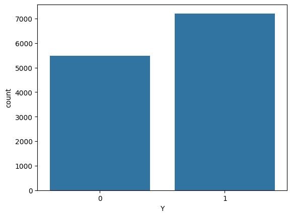
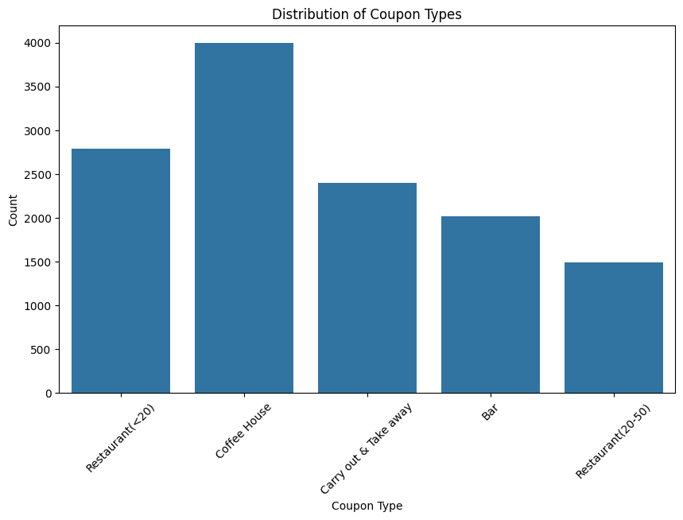
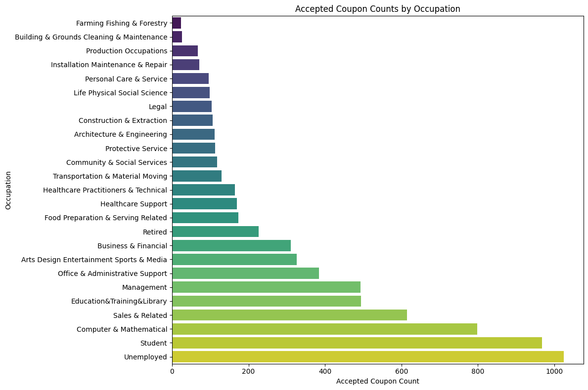
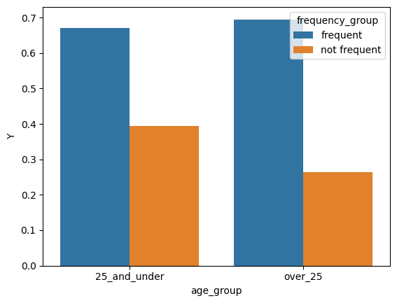
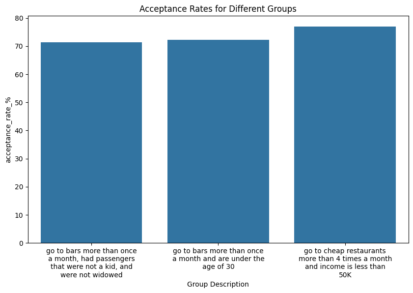

# Visualizing and Predicting Driving Coupon Acceptance

An Exploratory Data Analysis (EDA) exploring the driver and contextual attributes that influence whether a customer accepts an in-vehicle dining or coffee coupon, based on survey data from the UCI Machine Learning repository.

---

##  Project Overview
Imagine driving through town, and an alert chimed on your phone with a coupon for a restaurant or a coffee house nearby. Would you take a detour to accept it? Would your behavior shift based on the weather, the presence of a passenger, or the type of establishment?

The goal of this project is to distinguish between customers who accepted a driving coupon versus those who did not using statistical summaries, probability distributions, and data visualization. This analysis acts as a building block for future machine learning filtering algorithms intended to target customers with optimized in-vehicle coupon delivery.

---

##  Dataset Description
The dataset comes from the **UCI Machine Learning Repository** and was collected via crowdsourced surveys on Amazon Mechanical Turk. Each entry describes a unique driving scenario:
* **User Attributes:** Gender, Age, Marital Status, Children, Education, Occupation, Annual Income, and frequency of visiting bars/coffee houses/restaurants.
* **Contextual Attributes:** Destination (Home, Work, No Urgent Place), Location proximity (Map distance vectors/driving time info), Weather (Sunny, Rainy, Snowy), Temperature ($30^\circ F$, $55^\circ F$, $80^\circ F$), Time of day, and Passengers (Alone, Friend, Kid, Partner).
* **Coupon Attributes:** Venue category, Expiration timeframe (2 hours or 1 day).
* **Target Variable ($Y$):** `1` if the coupon was accepted (driver drove there right away or before expiration) or `0` if ignored/rejected.

### Coupon Categories:
1. Less expensive restaurants (under \$20)
2. Coffee houses
3. Carry out & Take away
4. Bars
5. More expensive restaurants (\$20 - \$50)

---

##  Data Cleaning & Structural Strategy
Before driving into insights, the raw dataset underwent specific preprocessing strategies:
* **Dropping High Null Values:** The `car` column was missing over 99.15% of its structural sequence data and was dropped entirely to preserve matrix integrity.
* **Imputing Missing Categorical Data:** Essential columns with marginal missing variables (`Bar`, `CoffeeHouse`, `CarryAway`, `RestaurantLessThan20`, `Restaurant20To50`) were handled by substituting missing instances with their respective column's **Mode** value.

---

##  Executive Summary of Key Insights

### 1. Overall Acceptance Metrics
* **Total Acceptance Rate:** **56.84%** of distributed coupons were accepted across all categories combined, leaving **43.16%** ignored or rejected.

 

### 2. General Distribution across Venues
Coupons targeted at less expensive restaurants and coffee shops yielded different yields of engagement. High-frequency coupon variants like "Carry out & Take away" or "Cheap Restaurants (<$20)" showed highly flexible acceptance indexes.






Drivers who accepted the bar coupons are likely:

* regular bar-goers (go to bars more than once a month)
* more often under 30 years old
* more likely to be riding with non-kid passengers and not widowed
* possibly more price-sensitive / lower income, since they also use cheap restaurants frequently

So the hypothesis is: accepted bar coupon drivers are generally younger, frequent bar customers, and may have lower income or value inexpensive entertainment options.





---

##  Tech Stack 
* **Language:** Python 3
* **Libraries:** * `pandas` for structural data frames manipulation
  * `numpy` for linear calculations
  * `matplotlib.pyplot` for foundational figures
  * `seaborn` for automated count plots and distribution grids
  * `textwrap` for plot lables wrapping
---

##  Repository Structure

├── data/
│   └── coupons.csv                                                # Raw dataset from UCI repository
├── images/                                                        # Plots from the EDA 
│   └── Coupon Accpetance and rejection overall.png                
│   └── Coupon_Type_distribution.png 
│   └── Coupon_accepted_by_population.png 
│   └── Analysis_under_and_over_25.png 
│   └── Analysis_across_groups.png 
├── prompt.ipynb                                                   # Main Jupyter Notebook containing the executable script & analysis
└── README.md                                                      # Project documentation and summary report

---

##  Running Instruction

pip install pandas numpy matplotlib seaborn notebook

jupyter notebook

Click on prompt.ipynb and run all cells sequentially.


```